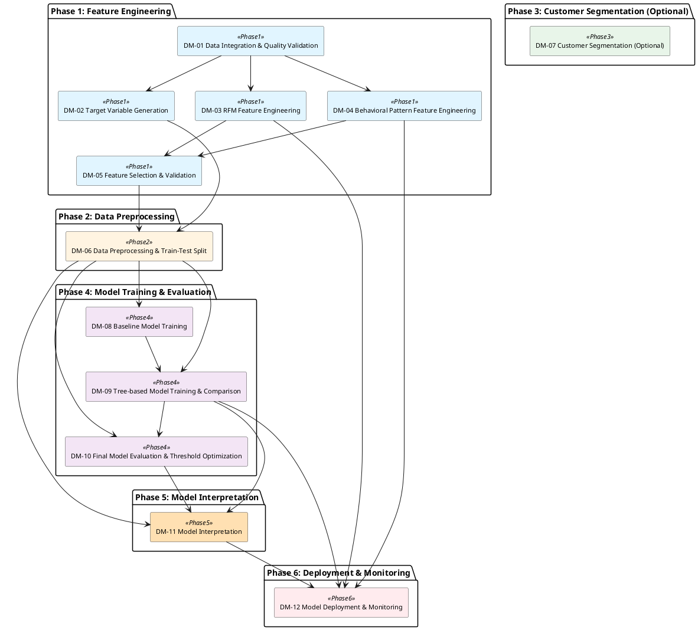

# MASTER DEVELOPMENT BLUEPRINT

> Tài liệu bàn giao cho coding agent: mục tiêu, requirement, ràng buộc, module boundary, pipeline và phân bổ hàm chi tiết.

## 1. PROBLEM PROFILE

**Business Goal:** Dự đoán khả năng khách hàng rời bỏ (churn) dựa trên dữ liệu giao dịch e-commerce, kết hợp với khả năng giải thích kết quả dựa vào các đặc trưng của dataset để triển khai chiến lược giữ chân hiệu quả
**Technical Objective:** Binary Classification — dự đoán xác suất churn của khách hàng (định nghĩa: không có đơn hàng trong 90 ngày) kết hợp với Model Interpretability để xác định các yếu tố ảnh hưởng đến quyết định dự đoán

### Success Criteria
- Đạt các metric định lượng do người dùng chỉ định: ROC-AUC, F1-Score, và Recall trên tập kiểm tra
- Mô hình có khả năng giải thích được kết quả dự đoán thông qua phân tích đóng góp của các đặc trưng (feature importance/SHAP)
- Hệ thống chạy được trên laptop cá nhân với RAM 8GB, không yêu cầu GPU

### Data Profile
- **Data type:** tabular
- **Volume:** ~100,000 đơn hàng từ ~96,096 khách hàng duy nhất trong 32 tháng
- **Schema:**
```json
{
  "source": "Olist Brazilian E-Commerce Dataset từ Kaggle",
  "tables": {
    "orders": {
      "rows": "~99,441",
      "key_fields": [
        "order_id (PK)",
        "customer_id (FK)",
        "order_status",
        "order_purchase_timestamp",
        "order_approved_at",
        "order_delivered_carrier_date",
        "order_delivered_customer_date",
        "order_estimated_delivery_date"
      ]
    },
    "sellers": {
      "key_fields": [
        "seller_id (PK)",
        "seller_zip_code_prefix",
        "seller_city",
        "seller_state"
      ]
    },
    "products": {
      "key_fields": [
        "product_id (PK)",
        "product_category_name",
        "product_weight_g",
        "product_photos_qty"
      ]
    },
    "customers": {
      "rows": "~99,441 (96,096 unique customers)",
      "key_fields": [
        "customer_id (PK)",
        "customer_unique_id",
        "customer_zip_code_prefix",
        "customer_city",
        "customer_state"
      ]
    },
    "geolocation": {
      "key_fields": [
        "geolocation_zip_code_prefix",
        "geolocation_lat",
        "geolocation_lng"
      ]
    },
    "order_items": {
      "rows": "~112,650",
      "key_fields": [
        "order_id (FK)",
        "order_item_id",
        "product_id (FK)",
        "seller_id (FK)",
        "price",
        "freight_value",
        "shipping_limit_date"
      ]
    },
    "order_reviews": {
      "key_fields": [
        "review_score (1-5)",
        "review_comment_title",
        "review_comment_message"
      ]
    },
    "order_payments": {
      "rows": "~103,886",
      "key_fields": [
        "order_id (FK)",
        "payment_type",
        "payment_installments",
        "payment_value"
      ]
    }
  },
  "time_coverage": "Tháng 01/2016 đến Tháng 08/2018 (32 tháng)",
  "target_definition": "Khách hàng được coi là churn nếu không có đơn hàng nào trong 90 ngày liên tiếp kể từ đơn hàng cuối cùng"
}
```

### Constraints
**Hạ tầng:**
- Laptop cá nhân không có GPU, RAM 8GB — giới hạn kích thước model, memory footprint trong training và inference
- Yêu cầu model có thể chạy hiệu quả trên CPU với latency chấp nhận được
- Training time cần hợp lý cho iteration nhanh trên máy local (không thể huấn luyện deep neural networks lớn)
**Vấn đề/rủi ro:**
- {"tag": "[Manual Review Required]", "issue": "Người dùng yêu cầu model interpretability nhưng chưa chỉ rõ mức độ chi tiết cần thiết (global vs local explanations, stakeholder nào cần hiểu, format báo cáo)", "suggestion": "Xác nhận với người dùng: Cần giải thích ở mức độ nào? Feature importance toàn cục đủ hay cần SHAP values cho từng dự đoán? Ai sẽ sử dụng explanations (data scientist, business stakeholder, end user)?"}
- {"tag": "[Note: Acceptance criteria cần bổ sung ngưỡng]", "issue": "Ngưỡng cụ thể cho các metric (ROC-AUC, F1, Recall) chưa được người dùng đưa ra", "suggestion": "Trong giai đoạn baseline, đề xuất sử dụng comparative evaluation (so sánh models) và sau đó xác định ngưỡng khả thi với người dùng dựa trên kết quả thực tế"}
- {"tag": "[Note: Ảnh hưởng đến deployment architecture]", "issue": "Chưa rõ prediction use case: batch scoring định kỳ hay real-time prediction khi khách hàng tương tác", "suggestion": "Nếu chỉ cần monthly/weekly batch scoring → đơn giản hóa deployment. Nếu cần real-time → tối ưu inference latency"}
- [Manual Review Required] Acceptance criteria của FR-03 có số định lượng từ CoResearch; chỉ được dùng sau khi user xác nhận hoặc chuyển thành quy trình đánh giá trên dataset người dùng.
- [Manual Review Required] Acceptance criteria của NFR-03 có số định lượng từ CoResearch; chỉ được dùng sau khi user xác nhận hoặc chuyển thành quy trình đánh giá trên dataset người dùng.
- [Manual Review Required] Acceptance criteria của DSR-02 có số định lượng từ CoResearch; chỉ được dùng sau khi user xác nhận hoặc chuyển thành quy trình đánh giá trên dataset người dùng.
- [Manual Review Required] Acceptance criteria của FR-07 có số định lượng từ CoResearch; chỉ được dùng sau khi user xác nhận hoặc chuyển thành quy trình đánh giá trên dataset người dùng.
**Thông tin còn thiếu:**
- {"field": "data_profile.class_distribution", "fallback": "Giả định có class imbalance và chuẩn bị kỹ thuật xử lý, nhưng không đưa tỷ lệ cụ thể vào spec", "severity": "WARN", "suggestion": "Yêu cầu người dùng chạy phân tích EDA cơ bản: Trong 96,096 khách hàng, có bao nhiêu % được label là churn (không mua trong 90 ngày cuối của dataset)?", "why_needed": "Tỷ lệ churn/non-churn thực tế trong dataset ảnh hưởng đến lựa chọn sampling strategy, class weights, và threshold optimization. Ảnh hưởng trực tiếp đến chiến lược đánh giá metric (đặc biệt Recall khi class imbalance)"}
- {"field": "data_profile.feature_availability", "fallback": "Giả định có thể sử dụng 6 bảng core (orders, customers, order_items, payments, products, sellers) với join success rate >90%", "severity": "WARN", "suggestion": "Yêu cầu người dùng kiểm tra: Tất cả 9 bảng đều có data? Join success rate giữa orders-customers-order_items-payments? Missing rate cho review data?", "why_needed": "Cần xác nhận các bảng nào trong 9 bảng schema thực sự có dữ liệu đầy đủ và có thể join được. Một số bảng có thể có missing rate cao hoặc không khớp key."}
- {"field": "problem_definition.metric_thresholds", "fallback": "Dùng comparative evaluation trong POC phase, sau đó đề xuất ngưỡng dựa trên baseline performance", "severity": "WARN", "suggestion": "Hỏi người dùng: Với business context này, metric nào quan trọng nhất? Có ngưỡng minimum acceptable không? (Ví dụ: Recall cao hơn ưu tiên vì cost of false negative > false positive?)", "why_needed": "Để xác định acceptance criteria rõ ràng cho model performance. Ví dụ: ROC-AUC ≥ 0.85? F1 ≥ 0.70? Recall ≥ 0.75?"}
- {"field": "problem_definition.deployment_timeline", "fallback": "Giả định đây là POC phase, tập trung vào model development và evaluation trước", "severity": "WARN", "suggestion": "Xác nhận với người dùng: Đây là dự án research/POC hay cần deploy production? Timeline mong đợi là bao lâu?", "why_needed": "Timeline ảnh hưởng đến phạm vi POC (proof-of-concept nhanh vs production-ready system)"}
- {"field": "constraints.data_quality_issues", "fallback": "Bao gồm data quality validation trong data preparation phase", "severity": "WARN", "suggestion": "Yêu cầu người dùng chạy data quality check: Có duplicate orders không? Timestamp logic có hợp lý không (purchase < approved < delivered)? Outliers trong price/freight_value?", "why_needed": "Các vấn đề data quality thực tế (duplicates, outliers, inconsistent timestamps) ảnh hưởng đến data cleaning effort và feature reliability"}
- {"field": "problem_definition.interpretability_requirements_detail", "fallback": "Cung cấp cả global (feature importance) và local (SHAP) explanations trong POC, để người dùng quyết định sau", "severity": "WARN", "suggestion": "Làm rõ với người dùng: (1) Ai cần hiểu model? Business stakeholder hay data scientist? (2) Cần giải thích toàn cục (top features) hay cụ thể cho từng khách hàng? (3) Format output: dashboard, report, API response?", "why_needed": "Mức độ chi tiết interpretability ảnh hưởng đến lựa chọn model architecture và explainability tools. Global feature importance khác với local SHAP explanations cho từng prediction."}

---

## 2. REQUIREMENTS CONTRACT

> Đây là nguồn ràng buộc chính để coding agent viết code đúng yêu cầu. Mỗi module/hàm nên trace về các ID này.

| ID | Type | Priority | Source | Requirement | Acceptance Criteria |
|---|---|---|---|---|---|
| FR-01 | FR | HIGH | user::dataset_schema + self_inferred | Xây dựng pipeline data preparation để tích hợp 9 bảng từ Olist dataset thành feature matrix dùng cho modeling, bao gồm handling missing values, join logic và data quality validation | Pipeline xử lý thành công toàn bộ ~100K orders từ 9 bảng CSV, tạo ra feature matrix với customer_unique_id làm unit of analysis. Data quality report xác nhận: (1) Join success rate ≥95% giữa core tables, (2) Missing value handling strategy được document rõ ràng, (3) Timestamp logic validation (purchase ≤ approved ≤ delivered) |
| FR-02 | FR | HIGH | user::query | Tạo target variable (churn label) dựa trên định nghĩa: khách hàng không có đơn hàng nào trong 90 ngày liên tiếp kể từ đơn hàng cuối cùng | Target variable được tính chính xác cho mỗi customer_unique_id tại mỗi thời điểm đánh giá. Validation: (1) Logic 90-day window được test với sample cases, (2) Temporal cutoff point được define rõ (ví dụ: evaluate churn tại tháng 8/2018), (3) Class distribution report (% churn vs non-churn) được tạo ra |
| FR-03 | FR | HIGH | user::query + coresearch::reference | Feature engineering: xây dựng features phản ánh hành vi mua sắm của khách hàng từ lịch sử giao dịch, bao gồm nhóm RFM (Recency, Frequency, Monetary) và behavioral patterns | Feature set bao gồm tối thiểu: (1) Recency features: days_since_last_order, trend indicators, (2) Frequency features: total_orders, order_frequency, purchase_cycle, (3) Monetary features: total_spend, average_order_value, (4) Behavioral features: category_diversity, payment_method_patterns, review_sentiment. Feature engineering code có unit tests và documentation. Feature correlation matrix được tạo để identify redundant features. |
| FR-04 | FR | HIGH | user::query | Huấn luyện và đánh giá multiple classification models để dự đoán churn probability, bao gồm tối thiểu: Logistic Regression (baseline), tree-based methods (Random Forest hoặc Gradient Boosting) | Mỗi model được train và evaluate với: (1) Time-series cross-validation để tránh data leakage, (2) Ba metrics được report: ROC-AUC, F1-Score, Recall, (3) Comparison report so sánh performance của các models, (4) Confusion matrix và classification report cho mỗi model, (5) Training time và memory footprint được ghi nhận để verify RAM 8GB constraint |
| FR-05 | FR | HIGH | user::query | Model interpretability: tạo explanations cho predictions để hiểu các yếu tố ảnh hưởng đến quyết định churn | Cung cấp cả global và local explanations: (1) Global: Feature importance ranking cho top 20 features, (2) Local: SHAP values hoặc tương đương cho sample predictions (ví dụ: 10 high-risk customers), (3) Visualization của feature contributions, (4) Documentation giải thích cách interpret explanations cho non-technical stakeholders |
| FR-06 | FR | HIGH | user::query + constraints | Model selection: lựa chọn model tốt nhất dựa trên trade-off giữa performance metrics, interpretability và resource constraints | Decision matrix đánh giá các models theo: (1) ROC-AUC, F1, Recall scores, (2) Training time và inference time trên laptop 8GB RAM, (3) Interpretability level, (4) Recommendation rõ ràng về model được chọn kèm justification. Nếu có trade-off (ví dụ: model A có AUC cao hơn nhưng kém interpretable hơn model B), thì phải document và đề xuất người dùng quyết định. |
| NFR-01 | NFR | HIGH | user::metadata | Model training và inference phải chạy được trên laptop cá nhân với RAM 8GB, không có GPU | Toàn bộ pipeline (data processing, training, inference) hoàn thành thành công trên môi trường: CPU-only, RAM ≤8GB. Memory profiling report xác nhận peak memory usage < 7GB (để có buffer). Training time cho final model ≤ 2 giờ. Inference time cho batch prediction 1000 customers ≤ 10 giây. |
| NFR-02 | NFR | MEDIUM | self_inferred::best_practice | Code quality: code phải có structure rõ ràng, reproducible, và maintainable | Project structure bao gồm: (1) Separate modules cho data processing, feature engineering, modeling, evaluation, (2) Requirements.txt hoặc environment.yml cho dependency management, (3) README với instructions để reproduce results, (4) Jupyter notebooks hoặc scripts có clear documentation và comments, (5) Random seed được set để reproducibility |
| NFR-03 | NFR | HIGH | coresearch::reference + self_inferred | Evaluation robustness: sử dụng time-series aware cross-validation để đánh giá model performance một cách đáng tin cậy trên temporal data | Cross-validation strategy: (1) Sử dụng time-series split (không shuffle data), (2) Train on earlier periods, test on later periods, (3) Minimum 3 folds, (4) Validation: performance metrics stable across folds (std < 0.05 cho AUC-ROC), (5) Documentation giải thích validation strategy và rationale |
| DSR-01 | DSR | HIGH | self_inferred::standard_practice | Exploratory Data Analysis (EDA): phân tích đặc tính dữ liệu để hiểu churn patterns và inform feature engineering | EDA report bao gồm: (1) Class distribution (churn rate), (2) Temporal patterns: churn rate by cohort, by month, (3) Customer segmentation analysis: new vs returning customers, (4) Feature distributions và correlations với target, (5) Data quality assessment: missing values, outliers, anomalies, (6) Key insights và hypotheses để guide modeling strategy |
| DSR-02 | DSR | MEDIUM | coresearch::reference | Reproducibility: toàn bộ analysis và modeling pipeline phải reproducible với random seed control | Random seeds được set ở tất cả các bước có random component: (1) Train-test split, (2) Cross-validation folds, (3) Model training (nếu có random init), (4) Feature sampling (nếu có). Verification: chạy pipeline 2 lần độc lập với cùng seed cho kết quả metrics giống hệt nhau (difference < 0.0001). |
| FR-07 | FR | MEDIUM | coresearch::reference + self_inferred | Threshold optimization: tìm optimal classification threshold dựa trên trade-off giữa precision và recall, phù hợp với business context | Analysis bao gồm: (1) Precision-Recall curve, (2) ROC curve với optimal threshold candidates, (3) Nếu người dùng cung cấp cost của false positive vs false negative, tính expected value cho các thresholds khác nhau, (4) Recommendation về threshold với justification. Nếu không có cost information, đề xuất threshold dựa trên balanced F1 hoặc yêu cầu người dùng clarify priority. |
| FR-08 | FR | MEDIUM | self_inferred::deliverable | Deliverables: tạo final report tổng hợp findings, model performance, và recommendations | Final report (PDF hoặc Jupyter notebook) bao gồm: (1) Executive summary với key findings, (2) Data analysis insights, (3) Model comparison và selection rationale, (4) Performance metrics trên test set, (5) Feature importance và interpretability analysis, (6) Recommendations cho deployment và next steps, (7) Limitations và known issues, (8) Appendix với technical details |

---

## 3. HIGH-LEVEL PIPELINE

### Phase 1: Feature Engineering
- **Mục tiêu:** Xây dựng feature matrix từ 9 bảng Olist dataset phản ánh hành vi mua sắm của khách hàng. Tạo RFM features (Recency, Frequency, Monetary) với temporal aggregations, behavioral features (category diversity, payment patterns, review sentiment), và features riêng cho khách hàng mới. Thực hiện feature selection để tối ưu số lượng features phù hợp với RAM constraint 8GB. [cite: chunk_0002, req_fr_02]
  - **Step 1.1**: RFM Feature Engineering (pandas)
    - Input: Joined dataset từ orders, order_items, payments tables với customer_unique_id làm key
    - Output: RFM feature matrix (customer_unique_id, recency_features, frequency_features, monetary_features) với temporal disaggregation
    - Addresses: FR-03
  - **Step 1.2**: Behavioral Pattern Features (pandas)
    - Input: Joined dataset từ order_items, products, payments, order_reviews tables
    - Output: Behavioral feature matrix (customer_unique_id, diversity_metrics, payment_patterns, review_signals, new_customer_indicators)
    - Addresses: FR-03
  - **Step 1.3**: Feature Selection và Validation (scikit-learn)
    - Input: Combined feature matrix từ steps 1.1 và 1.2
    - Output: Final feature matrix sau feature selection, data quality report (missing rates, correlation matrix, selected feature list)
    - Addresses: FR-03, NFR-01
### Phase 2: Data Preprocessing
- **Mục tiêu:** Chuẩn bị feature matrix từ Phase 1 cho modeling bằng cách xử lý missing values, phát hiện và xử lý outliers, đánh giá và xử lý class imbalance nếu cần, và chuẩn hóa features khi cần thiết. Đảm bảo data quality thông qua validation checks và tạo train-test split tuân thủ temporal ordering để tránh data leakage.
  - **Step 2.1**: Missing Values và Data Quality (pandas)
    - Input: Feature matrix từ Phase 1 với potential missing values trong timestamp fields và review-related features
    - Output: Feature matrix đã xử lý missing values, có outlier detection report và cleaned data
    - Addresses: FR-01, DSR-01
  - **Step 2.2**: Class Imbalance Assessment và Xử Lý (scikit-learn)
    - Input: Feature matrix đã cleaned với target variable (churn labels)
    - Output: Class distribution report, feature matrix với class weight strategy (nếu cần)
    - Addresses: FR-04, NFR-01
  - **Step 2.3**: Feature Scaling và Train-Test Split (scikit-learn)
    - Input: Feature matrix với class imbalance đã được xử lý
    - Output: Scaled features (nếu cần), train set và test set tuân thủ temporal ordering, data split metadata (cutoff date, size)
    - Addresses: NFR-03, DSR-02
### Phase 3: Customer Segmentation (Optional)
- **Mục tiêu:** Áp dụng K-means clustering để phân khách hàng thành các nhóm dựa trên RFM features từ Phase 1. Xác định core customer segments với đặc điểm churn khác biệt, nhằm cung cấp thêm góc nhìn cho business insights và tùy chọn thêm cluster labels làm feature cho Phase 4. Phase này là optional — chỉ thực hiện sau khi đánh giá baseline models để xác định liệu segmentation có đóng góp giá trị đáng kể hay không [Self-Inferred — dựa trên G2 đánh dấu Optional và yêu cầu interpretability từ G1]
  - **Step 3.1**: Xác định số clusters tối ưu (scikit-learn KMeans)
    - Input: Feature matrix đã chuẩn hóa từ Phase 1 (RFM + behavioral features)
    - Output: Optimal number of clusters dựa trên Elbow và Silhouette analysis, visualization charts
    - Addresses: DSR-01
  - **Step 3.2**: Thực hiện clustering và phân tích segments (scikit-learn KMeans)
    - Input: Feature matrix và optimal k từ step 3.1
    - Output: Cluster labels cho mỗi khách hàng, segment profiling report (RFM characteristics, churn rate per cluster, size distribution)
    - Addresses: DSR-01
  - **Step 3.3**: Đánh giá business value của segmentation (scikit-learn KMeans)
    - Input: Cluster labels và segment profiles từ step 3.2
    - Output: Evaluation report: churn rate per cluster, statistical tests (ANOVA/Chi-square) để xác nhận sự khác biệt có ý nghĩa, recommendation về việc có nên sử dụng cluster labels trong modeling hay không
    - Addresses: DSR-01
### Phase 4: Model Training & Evaluation
- **Mục tiêu:** Huấn luyện và đánh giá nhiều classification models (Logistic Regression, Random Forest, XGBoost, LightGBM) để dự đoán churn probability trên dataset Olist thực tế của người dùng. Thực hiện time-series cross-validation để tránh data leakage và đo lường performance qua ba metrics: ROC-AUC, F1-Score, và Recall. So sánh các models dựa trên trade-off giữa performance, training time, memory footprint, và interpretability để đề xuất model phù hợp với constraint RAM 8GB và yêu cầu giải thích kết quả [cite: chunk_0006]
  - **Step 4.1**: Baseline Model Training (scikit-learn LogisticRegression)
    - Input: Feature matrix (train set) với target variable từ Phase 3
    - Output: Trained baseline model, cross-validation metrics (ROC-AUC, F1, Recall per fold), training time và memory profile
    - Addresses: FR-04, NFR-01, NFR-03
  - **Step 4.2**: Tree-based Models Training & Comparison (scikit-learn RandomForestClassifier, xgboost.XGBClassifier, lightgbm.LGBMClassifier, pandas, matplotlib)
    - Input: Feature matrix (train/validation sets), baseline results từ step 4.1
    - Output: Trained tree-based models, comprehensive comparison report với visualization, final model recommendation với justification rõ ràng về trade-offs
    - Addresses: FR-04, FR-06, NFR-01, NFR-02, NFR-03
  - **Step 4.3**: Final Model Evaluation & Test Set Performance (scikit-learn metrics, matplotlib, seaborn)
    - Input: Final selected model từ step 4.2, test set từ Phase 3
    - Output: Test set performance metrics (ROC-AUC, F1, Recall), confusion matrix, ROC curve, Precision-Recall curve, performance summary report
    - Addresses: FR-04, FR-06, FR-07, FR-08, NFR-02
### Phase 5: Model Interpretation
- **Mục tiêu:** Trích xuất và phân tích khả năng giải thích của model đã chọn từ Phase 4 để xác định các yếu tố ảnh hưởng đến dự đoán churn. Cung cấp cả global explanations (feature importance ranking) và local explanations (SHAP values cho sample predictions) nhằm đáp ứng yêu cầu interpretability của stakeholders và hỗ trợ business validation cho chiến lược retention. [cite: chunk_0007]
  - **Step 5.1**: Global Feature Importance (scikit-learn feature_importances_ (tree-based models) hoặc coefficients (Logistic Regression), matplotlib)
    - Input: Trained model từ Phase 4, feature names và definitions
    - Output: Feature importance ranking (top 20), visualization bar chart, phân tích nhóm features theo business logic
    - Addresses: FR-05, FR-08
  - **Step 5.2**: Local Explanations với SHAP (shap library (TreeExplainer cho tree-based models, LinearExplainer cho Logistic Regression))
    - Input: Trained model, feature matrix của sample cases, test set predictions với high churn probability
    - Output: SHAP values cho sample cases, waterfall plots và force plots visualization, interpretation guide
    - Addresses: FR-05
  - **Step 5.3**: Interpretability Report (pandas, matplotlib, Jupyter notebook hoặc PDF export)
    - Input: Feature importance từ 5.1, SHAP analysis từ 5.2, business context từ G1
    - Output: Interpretability report bao gồm: global insights, local case studies, business recommendations, interpretation guidelines cho non-technical users [cite: chunk_0007]
    - Addresses: FR-05, FR-08
### Phase 6: Deployment & Monitoring
- **Mục tiêu:** Chuẩn bị model đã chọn từ Phase 4 để triển khai sử dụng trên dataset Olist. Serialize model artifact với joblib, xây dựng inference pipeline cho batch scoring (dự đoán churn cho toàn bộ customer base), và thiết lập monitoring cơ bản để tracking model performance theo thời gian. Đảm bảo pipeline chạy được trên môi trường laptop 8GB RAM và tạo tài liệu hướng dẫn deployment cho người dùng.
  - **Step 6.1**: Model Serialization (joblib)
    - Input: Trained model object từ Phase 4, model performance metrics từ Phase 5
    - Output: Serialized model file (.pkl hoặc .joblib), model metadata JSON (version, features, metrics)
    - Addresses: FR-06, NFR-02, DSR-02
  - **Step 6.2**: Batch Scoring Pipeline (pandas + Python scripting)
    - Input: Serialized model từ step 6.1, raw data từ 9 bảng Olist, feature engineering functions từ Phase 1
    - Output: Batch prediction output (customer_id, churn_probability, risk_segment), execution log với memory usage
    - Addresses: FR-06, NFR-01, NFR-02
  - **Step 6.3**: Performance Monitoring Setup (pandas + matplotlib)
    - Input: Prediction output từ step 6.2, ground truth labels (nếu có), historical prediction distributions
    - Output: Performance monitoring report (metrics over time, prediction distribution charts), deployment documentation cho người dùng
    - Addresses: FR-08, NFR-02

---

## 4. SELECTED TECHNOLOGY STACK

| Task | Final Solution | Type | Addresses | Rationale / Trade-off |
|---|---|---|---|---|
| Model Training - Logistic Regression | scikit-learn LogisticRegression | Bên ngoài | FR-04, FR-05, FR-06, NFR-01, NFR-02 | Không tìm thấy công cụ nội bộ cho binary classification với Logistic Regression trong Internal KB. scikit-learn là thư viện tiêu chuẩn công nghiệp cho machine learning với CPU, đáp ứng constraint laptop 8GB RAM không GPU. Training time <1 phút cho 100K records phù hợp với yêu cầu iteration nhanh Reported benchmark note: CoResearch báo cáo AUC-ROC 0.88 cho LR baseline trên e-commerce churn dataset — đây chỉ là tham khảo, không phải target cho dataset người dùng |
| Model Training - Random Forest | scikit-learn RandomForestClassifier | Bên ngoài | FR-04, FR-05, FR-06, NFR-01, NFR-02 | Không tìm thấy công cụ nội bộ cho Random Forest trong Internal KB. RF đáp ứng yêu cầu người dùng về tree-based method trong FR-04, có khả năng học non-linear patterns, và chạy hiệu quả trên CPU với parallel training. Memory footprint moderate (~500MB-2GB) nằm trong giới hạn RAM 8GB Reported benchmark note: CoResearch báo cáo AUC-ROC 0.97 cho RF trên e-commerce context — đây chỉ là tham khảo, không phải target cho dataset người dùng |
| Model Training - XGBoost | xgboost.XGBClassifier | Bên ngoài | FR-04, FR-05, FR-06, NFR-01 | Không tìm thấy công cụ nội bộ cho gradient boosting trong Internal KB. XGBoost đáp ứng yêu cầu gradient boosting method trong FR-04, có built-in class imbalance handling (scale_pos_weight) quan trọng cho dữ liệu churn imbalanced, và xử lý missing values tự động. Training 15-45 phút trên CPU, memory 1-3GB nằm trong constraint NFR-01 Reported benchmark note: CoResearch báo cáo AUC-ROC 0.97 cho XGBoost trên e-commerce churn — đây chỉ là tham khảo, không phải target |
| Model Training - LightGBM (Primary Recommendation) | lightgbm.LGBMClassifier | Bên ngoài | FR-04, FR-05, FR-06, NFR-01, NFR-03 | Không tìm thấy công cụ nội bộ cho gradient boosting trong Internal KB. G2 và CoResearch đều recommend LightGBM là primary model vì: (1) Training 2-3× nhanh hơn XGBoost (10-15 phút cho 100K records), (2) Memory efficiency tốt hơn, quan trọng với constraint RAM 8GB, (3) Inference latency thấp 2-3ms với ONNX serialization, (4) Leaf-wise tree growth hiệu quả với high-dimensional features (100-200+). Industry adoption cao (Alibaba, Microsoft, Booking.com) Reported benchmark note: CoResearch báo cáo comparable accuracy với XGBoost (AUC-ROC ~0.97) và inference 2-3ms — đây chỉ là tham khảo |
| Model Interpretation - SHAP Values | shap library | Bên ngoài | FR-05, FR-06 | Không tìm thấy công cụ nội bộ cho model interpretability với SHAP values trong Internal KB. SHAP là yêu cầu bắt buộc từ FR-05 để cung cấp local explanations cho sample predictions. SHAP critical cho stakeholder trust, regulatory compliance (GDPR Article 22), và business logic validation theo CoResearch. Hỗ trợ tất cả tree-based models (RF, XGBoost, LightGBM) |
| Data Manipulation - pandas & numpy | pandas + numpy | Bên ngoài | FR-01, FR-03, DSR-01 | Không tìm thấy công cụ nội bộ cho tabular data manipulation trong Internal KB. pandas/numpy là dependencies cơ bản cho toàn bộ data science pipeline trong Python: (1) FR-01 data preparation từ 9 bảng CSV cần pandas DataFrame operations, (2) FR-03 feature engineering cần pandas aggregations và time-windowed calculations, (3) CoResearch đề cập pandas.DataFrame.corr() cho correlation analysis trong feature selection. Là standard library, không thể thay thế |
| Visualization - matplotlib & seaborn | matplotlib + seaborn | Bên ngoài | FR-05, FR-07, FR-08, DSR-01 | Không tìm thấy công cụ nội bộ cho data visualization trong Internal KB. Visualization là yêu cầu trong FR-05 (visualization của feature contributions), FR-07 (Precision-Recall curve, ROC curve), FR-08 (final report với charts), và DSR-01 (EDA report). matplotlib/seaborn là standard libraries cho Python visualization |
| Class Imbalance Handling - SMOTE | imbalanced-learn (imblearn) hoặc algorithmic approach (class weights) | Bên ngoài | FR-04, NFR-01 | Không tìm thấy công cụ nội bộ cho class imbalance handling trong Internal KB. CoResearch xác định class imbalance là thách thức lớn nhất. Tuy nhiên, có 2 approaches: (1) SMOTE oversampling (imblearn library) hoặc (2) Algorithmic adjustments (class weights trong LightGBM/XGBoost, không cần thư viện mới). CoResearch recommend class weights (scale_pos_weight) vì tránh computational overhead và không alter data |
| Customer Segmentation - K-means Clustering | scikit-learn KMeans (Optional) | Bên ngoài |  | Không tìm thấy công cụ nội bộ cho clustering trong Internal KB. CoResearch đề xuất hybrid approach (k-means + SVM) cải thiện đáng kể accuracy, nhưng G2 đánh dấu bước này là Optional. K-means sẵn có trong scikit-learn (đã là dependency cho LR/RF). Tuy nhiên, người dùng chưa yêu cầu clustering trong Requirements Contract. Nên thực hiện baseline models trước, sau đó evaluate xem clustering có cần thiết không Reported benchmark note: CoResearch báo cáo hybrid k-means+SVM cải thiện mỗi chỉ số dự đoán đáng kể — không có số cụ thể, chỉ tham khảo |
| Time-Series Cross-Validation | scikit-learn TimeSeriesSplit | Bên ngoài | NFR-03, FR-04 | Không tìm thấy công cụ nội bộ cho time-series cross-validation trong Internal KB. TimeSeriesSplit là yêu cầu bắt buộc từ NFR-03 để tránh data leakage trên temporal data. CoResearch nhấn mạnh strict no-leakage constraints và concept drift là critical challenge. TimeSeriesSplit đã có sẵn trong scikit-learn (dependency chung), không cần thư viện mới |
| RFM Feature Engineering | Custom pandas code (không có library riêng) | Nội bộ | FR-03 | RFM feature engineering không phải là library mà là business logic cần implement custom bằng pandas aggregations. CoResearch nhấn mạnh RFM-D framework (Recency, Frequency, Monetary, Duration) với time-windowed aggregates. Đây là domain-specific logic theo FR-03, không có off-the-shelf library. Implementation bằng pandas đã là dependency có sẵn |
| Model Persistence & Serialization | joblib (từ scikit-learn ecosystem) | Bên ngoài | FR-06, NFR-01, NFR-02 | Không tìm thấy công cụ nội bộ cho model serialization trong Internal KB. Model persistence cần thiết cho FR-06 (model selection và deployment) và NFR-02 (reproducibility). joblib efficient hơn pickle cho large numpy arrays, là standard trong scikit-learn ecosystem. CoResearch đề cập ONNX Runtime có thể optimize inference latency nhưng đó là advanced optimization, không cần thiết cho POC/baseline |
| Threshold Optimization | scikit-learn metrics + custom logic | Nội bộ | FR-07 | Threshold optimization logic cần implement custom dựa trên scikit-learn metrics. FR-07 yêu cầu Precision-Recall curve, ROC curve, và optional expected value calculation nếu user cung cấp cost. scikit-learn cung cấp precision_recall_curve và roc_curve functions, nhưng optimization logic (evaluate thresholds 0.1-0.9, calculate expected value, select optimal) là custom business logic |
| Data Quality Validation | Custom pandas validation logic (baseline) hoặc Great Expectations (advanced) | Nội bộ | FR-01, DSR-01 | Không tìm thấy công cụ nội bộ cho automated data validation trong Internal KB. FR-01 yêu cầu data quality validation (join success rate, missing value handling, timestamp logic). CoResearch đề cập Great Expectations cho schema compliance và value range checks, nhưng đây là advanced tool. Cho baseline/POC, có thể implement validation bằng pandas assertions và custom checks. Nếu cần production-grade validation framework, xem xét Great Expectations sau |
| Monitoring & Concept Drift Detection | Custom implementation (không có trong baseline scope) | Nội bộ |  | CoResearch nhấn mạnh concept drift monitoring quan trọng cho temporal e-commerce data, nhưng Requirements Contract không có yêu cầu rõ ràng về monitoring system (chỉ đề cập trong Domain Specific context). Monitoring là post-deployment concern, không cần thiết cho baseline model training và evaluation. Nếu user cần deploy production, cần discuss monitoring strategy riêng (PSI calculation, feature importance drift tracking, performance degradation alerts) |

---

## 5. MODULAR DESIGN PACKAGE

### DM-01 — Data Integration & Quality Validation
- **Purpose:** Tích hợp 9 bảng Olist dataset, thực hiện join logic, xử lý missing values trong raw data, và validate data quality trước khi feature engineering. Tạo consolidated dataset với customer_unique_id làm unit of analysis.
- **Phase IDs:** 1
- **Step IDs:** 1.1, 1.2
- **Owned requirements:** FR-01, DSR-01
- **Inputs:** 9 CSV files từ Olist dataset (orders, order_items, payments, products, customers, geolocation, order_reviews, sellers, product_category_name_translation)
- **Outputs:** Joined dataset với customer_unique_id key, data quality report (join success rate, missing value summary, timestamp validation results)
- **Depends on:** N/A
- **Downstream consumers:** DM-02, DM-03, DM-04
- **Invariants:**
  - Join success rate ≥95% giữa core tables
  - Timestamp logic: purchase_timestamp ≤ approved_at ≤ delivered_customer_date
  - customer_unique_id không null trong output

### DM-02 — Target Variable Generation
- **Purpose:** Tạo churn label dựa trên định nghĩa 90-day window: khách hàng không có đơn hàng nào trong 90 ngày liên tiếp kể từ đơn hàng cuối cùng. Xác định temporal cutoff point và tính class distribution.
- **Phase IDs:** 1
- **Step IDs:** N/A
- **Owned requirements:** FR-02
- **Inputs:** Joined dataset từ DM-01 với order timestamps
- **Outputs:** Target variable (churn label) cho mỗi customer_unique_id, class distribution report (% churn vs non-churn), temporal cutoff metadata
- **Depends on:** DM-01
- **Downstream consumers:** DM-06
- **Invariants:**
  - 90-day window logic consistent cho tất cả customers
  - Temporal cutoff point được document rõ ràng
  - Churn label binary (0/1)

### DM-03 — RFM Feature Engineering
- **Purpose:** Tạo Recency, Frequency, Monetary features với temporal aggregations (multiple time windows: 7/30/60/90/180 days) để capture dynamic customer behavior. Bao gồm recency trend, order frequency, purchase cycle, total spend, AOV, và AOV trend.
- **Phase IDs:** 1
- **Step IDs:** 1.1
- **Owned requirements:** FR-03
- **Inputs:** Joined dataset từ DM-01 (orders, order_items, payments tables)
- **Outputs:** RFM feature matrix (customer_unique_id, recency_features, frequency_features, monetary_features) với temporal disaggregation
- **Depends on:** DM-01
- **Downstream consumers:** DM-05, DM-12
- **Invariants:**
  - Time windows: 7, 30, 60, 90, 180 days (có thể điều chỉnh theo RAM constraint)
  - Missing values trong timestamp fields được handle với indicator features
  - Monetary values non-negative

### DM-04 — Behavioral Pattern Feature Engineering
- **Purpose:** Tạo behavioral features: category diversity (Herfindahl index, unique categories), payment patterns (payment_type distribution, installment usage), review sentiment (avg review_score, review engagement), và new customer indicators.
- **Phase IDs:** 1
- **Step IDs:** 1.2
- **Owned requirements:** FR-03
- **Inputs:** Joined dataset từ DM-01 (order_items, products, payments, order_reviews tables)
- **Outputs:** Behavioral feature matrix (customer_unique_id, diversity_metrics, payment_patterns, review_signals, new_customer_indicators)
- **Depends on:** DM-01
- **Downstream consumers:** DM-05, DM-12
- **Invariants:**
  - Herfindahl index ∈ [0,1]
  - Review features handle missing values (không phải tất cả orders có reviews)
  - Payment pattern features normalized

### DM-05 — Feature Selection & Validation
- **Purpose:** Combine RFM và behavioral features, áp dụng correlation filtering và variance threshold để reduce dimensionality phù hợp với RAM constraint. Tạo final feature matrix và data quality report.
- **Phase IDs:** 1
- **Step IDs:** 1.3
- **Owned requirements:** FR-03, NFR-01
- **Inputs:** RFM feature matrix từ DM-03, Behavioral feature matrix từ DM-04
- **Outputs:** Final feature matrix sau feature selection, correlation matrix, data quality report (missing rates, selected feature list)
- **Depends on:** DM-03, DM-04
- **Downstream consumers:** DM-06
- **Invariants:**
  - Feature count được tối ưu cho RAM 8GB constraint
  - Correlation threshold để loại bỏ redundant features (|corr| > 0.9)
  - Feature list documentation đầy đủ

### DM-06 — Data Preprocessing & Train-Test Split
- **Purpose:** Xử lý missing values trong feature matrix, phát hiện outliers, đánh giá class imbalance, áp dụng feature scaling nếu cần, và tạo train-test split theo temporal ordering để tránh data leakage.
- **Phase IDs:** 2
- **Step IDs:** 2.1, 2.2, 2.3
- **Owned requirements:** FR-01, FR-04, NFR-01, NFR-03, DSR-01, DSR-02
- **Inputs:** Final feature matrix từ DM-05, Target variable từ DM-02
- **Outputs:** Train set, validation set, test set (temporal split), class distribution report, outlier detection report, scaling metadata (nếu có)
- **Depends on:** DM-05, DM-02
- **Downstream consumers:** DM-08, DM-09, DM-10, DM-11
- **Invariants:**
  - Temporal ordering: train < validation < test
  - No data leakage: scaling parameters fitted on train only
  - Class weights strategy documented nếu có imbalance

### DM-07 — Customer Segmentation (Optional)
- **Purpose:** Áp dụng K-means clustering để phân khách hàng thành segments dựa trên RFM features. Phân tích churn rate per segment và quyết định có sử dụng cluster labels làm feature bổ sung hay không.
- **Phase IDs:** 3
- **Step IDs:** 3.1, 3.2, 3.3
- **Owned requirements:** DSR-01
- **Inputs:** Feature matrix đã chuẩn hóa từ DM-06 (RFM + behavioral features)
- **Outputs:** Cluster labels cho mỗi customer, segment profiling report, evaluation report (churn rate per cluster, statistical tests), recommendation về việc sử dụng cluster labels
- **Depends on:** N/A
- **Downstream consumers:** N/A
- **Invariants:**
  - Optimal k determined via Elbow + Silhouette analysis
  - Cluster separation có ý nghĩa thống kê (ANOVA/Chi-square p < 0.05)
  - Module chỉ execute nếu người dùng xác nhận muốn segmentation

### DM-08 — Baseline Model Training
- **Purpose:** Huấn luyện Logistic Regression làm baseline model với time-series cross-validation. Đo lường ROC-AUC, F1-Score, Recall và ghi nhận training time, memory usage.
- **Phase IDs:** 4
- **Step IDs:** 4.1
- **Owned requirements:** FR-04, NFR-01, NFR-03
- **Inputs:** Train set và validation set từ DM-06
- **Outputs:** Trained Logistic Regression model, cross-validation metrics (ROC-AUC, F1, Recall per fold), training time và memory profile
- **Depends on:** DM-06
- **Downstream consumers:** DM-09
- **Invariants:**
  - Time-series cross-validation với minimum 3 folds
  - Random seed set cho reproducibility
  - Peak memory < 7GB

### DM-09 — Tree-based Model Training & Comparison
- **Purpose:** Huấn luyện Random Forest, XGBoost, LightGBM với time-series CV và hyperparameter tuning. So sánh tất cả models dựa trên performance, training time, memory, interpretability. Chọn final model với justification.
- **Phase IDs:** 4
- **Step IDs:** 4.2
- **Owned requirements:** FR-04, FR-06, NFR-01, NFR-02, NFR-03
- **Inputs:** Train set và validation set từ DM-06, Baseline results từ DM-08
- **Outputs:** Trained tree-based models (RF, XGBoost, LightGBM), comprehensive comparison report với visualization, final model recommendation với trade-off analysis
- **Depends on:** DM-06, DM-08
- **Downstream consumers:** DM-10, DM-11, DM-12
- **Invariants:**
  - Time-series CV consistent với baseline
  - Hyperparameter tuning không vượt quá RAM constraint
  - Comparison report bao gồm tất cả 4 models

### DM-10 — Final Model Evaluation & Threshold Optimization
- **Purpose:** Đánh giá final model trên test set, tạo confusion matrix, ROC curve, Precision-Recall curve. Tối ưu classification threshold dựa trên business context hoặc balanced F1.
- **Phase IDs:** 4
- **Step IDs:** 4.3
- **Owned requirements:** FR-04, FR-06, FR-07, FR-08, NFR-02
- **Inputs:** Final selected model từ DM-09, Test set từ DM-06
- **Outputs:** Test set performance metrics (ROC-AUC, F1, Recall), confusion matrix, ROC curve, Precision-Recall curve, optimal threshold recommendation, performance summary report
- **Depends on:** DM-09, DM-06
- **Downstream consumers:** DM-11
- **Invariants:**
  - Test set độc lập, chưa được dùng trong training/validation
  - Threshold optimization documented với justification
  - Performance metrics đáp ứng minimum thresholds (nếu có)

### DM-11 — Model Interpretation
- **Purpose:** Trích xuất global feature importance (top 20) và local explanations (SHAP values cho sample high-risk customers). Tạo interpretability report cho stakeholders.
- **Phase IDs:** 5
- **Step IDs:** 5.1, 5.2, 5.3
- **Owned requirements:** FR-05, FR-08
- **Inputs:** Trained model từ DM-09, Feature matrix từ DM-06, Test set predictions từ DM-10
- **Outputs:** Feature importance ranking (top 20), SHAP values cho sample cases, waterfall plots, force plots, interpretability report với business context
- **Depends on:** DM-09, DM-06, DM-10
- **Downstream consumers:** DM-12
- **Invariants:**
  - Global importance và local SHAP consistent với model type
  - Sample cases cover diverse churn probabilities
  - Report accessible cho non-technical users

### DM-12 — Model Deployment & Monitoring
- **Purpose:** Serialize final model với joblib, xây dựng batch scoring pipeline cho ~96K customers, thiết lập performance monitoring cơ bản. Tạo deployment documentation.
- **Phase IDs:** 6
- **Step IDs:** 6.1, 6.2, 6.3
- **Owned requirements:** FR-06, FR-08, NFR-01, NFR-02, DSR-02
- **Inputs:** Final model từ DM-09, Model metadata từ DM-10, Feature engineering logic từ DM-03 và DM-04, Raw Olist data
- **Outputs:** Serialized model file (.pkl/.joblib), model metadata JSON, batch prediction output (customer_id, churn_probability, risk_segment), performance monitoring report, deployment documentation
- **Depends on:** DM-09, DM-03, DM-04, DM-11
- **Downstream consumers:** N/A
- **Invariants:**
  - Model loading và inference validated trên sample data
  - Batch scoring pipeline xử lý ~96K customers trong RAM 8GB
  - Monitoring baseline prediction distribution documented

### Module Interaction PlantUML



---

## 6. EXECUTION BLUEPRINT

## PART A: Codebase Structure
```text
project_root/
├── src/
│   ├── data_integration/
│   │   ├── __init__.py
│   │   ├── loader.py
│   │   ├── joiner.py
│   │   ├── quality_validator.py
│   │   └── consolidator.py
│   ├── target_generation/
│   │   ├── __init__.py
│   │   ├── churn_labeler.py
│   │   └── temporal_cutoff.py
│   ├── feature_engineering/
│   │   ├── __init__.py
│   │   ├── rfm/
│   │   │   ├── __init__.py
│   │   │   ├── recency_features.py
│   │   │   ├── frequency_features.py
│   │   │   ├── monetary_features.py
│   │   │   └── aggregator.py
│   │   └── behavioral/
│   │       ├── __init__.py
│   │       ├── category_features.py
│   │       ├── payment_features.py
│   │       ├── review_features.py
│   │       ├── customer_status.py
│   │       └── aggregator.py
│   ├── feature_selection/
│   │   ├── __init__.py
│   │   ├── combiner.py
│   │   ├── selector.py
│   │   └── validator.py
│   ├── preprocessing/
│   │   ├── __init__.py
│   │   ├── missing_handler.py
│   │   ├── outlier_detector.py
│   │   ├── scaler.py
│   │   └── splitter.py
│   ├── segmentation/
│   │   ├── __init__.py
│   │   ├── kmeans_clusterer.py
│   │   ├── segment_profiler.py
│   │   └── evaluator.py
│   ├── modeling/
│   │   ├── __init__.py
│   │   ├── baseline/
│   │   │   ├── __init__.py
│   │   │   ├── logistic_trainer.py
│   │   │   └── evaluator.py
│   │   └── tree_based/
│   │       ├── __init__.py
│   │       ├── rf_trainer.py
│   │       ├── xgboost_trainer.py
│   │       ├── lightgbm_trainer.py
│   │       └── comparator.py
│   ├── evaluation/
│   │   ├── __init__.py
│   │   ├── test_evaluator.py
│   │   ├── curve_generator.py
│   │   ├── threshold_optimizer.py
│   │   └── report_generator.py
│   ├── interpretation/
│   │   ├── __init__.py
│   │   ├── feature_importance.py
│   │   ├── shap_explainer.py
│   │   └── report_builder.py
│   ├── deployment/
│   │   ├── __init__.py
│   │   ├── model_serializer.py
│   │   ├── batch_scorer.py
│   │   ├── monitor.py
│   │   └── documentation_generator.py
│   ├── eda/
│   │   ├── __init__.py
│   │   ├── temporal_analyzer.py
│   │   ├── customer_profiler.py
│   │   ├── feature_analyzer.py
│   │   └── report_generator.py
│   └── utils/
│       ├── __init__.py
│       ├── logger.py
│       ├── config.py
│       ├── seed_manager.py
│       ├── memory_profiler.py
│       └── io_helper.py
├── notebooks/
│   ├── 01_data_exploration.ipynb
│   ├── 02_feature_engineering.ipynb
│   ├── 03_modeling_experiments.ipynb
│   ├── 04_model_interpretation.ipynb
│   └── 05_final_report.ipynb
├── tests/
│   ├── __init__.py
│   ├── test_data_integration.py
│   ├── test_feature_engineering.py
│   ├── test_churn_labeler.py
│   ├── test_preprocessing.py
│   └── test_reproducibility.py
├── data/
│   ├── raw/              # Olist CSV files (gitignored)
│   ├── processed/        # Intermediate datasets (gitignored)
│   └── features/         # Final feature matrices (gitignored)
├── models/               # Trained models (gitignored)
├── reports/              # Generated reports, figures (gitignored)
├── logs/                 # Execution logs (gitignored)
├── requirements.txt
├── config.yaml
├── README.md
├── .gitignore
└── run_pipeline.py
```

## PART A.1: Codebase Modules
### `CB-01` — `src/data_integration/`
- **Design module:** DM-01
- **Responsibility:** Tích hợp 9 bảng Olist dataset, thực hiện join logic, xử lý missing values, validate data quality. Tạo consolidated dataset với customer_unique_id làm unit of analysis.
- **Owned requirements:** FR-01, DSR-01
- **Files:**
  - `src/data_integration/loader.py` — Load 9 CSV files từ Olist dataset, validate schema và basic data types
  - `src/data_integration/joiner.py` — Thực hiện join logic giữa các bảng (orders, customers, items, payments, reviews, products, sellers, geolocation, translations). Tính join success rate.
  - `src/data_integration/quality_validator.py` — Validate data quality: missing values, timestamp logic (purchase <= approved <= delivered), outliers. Tạo data quality report.
  - `src/data_integration/consolidator.py` — Aggregate data về customer_unique_id level, xử lý missing values theo strategy đã định. Output consolidated dataset.

### `CB-02` — `src/target_generation/`
- **Design module:** DM-02
- **Responsibility:** Tạo churn label dựa trên 90-day window definition. Xác định temporal cutoff point và tính class distribution.
- **Owned requirements:** FR-02
- **Files:**
  - `src/target_generation/churn_labeler.py` — Tính churn label cho mỗi customer_unique_id dựa trên 90-day inactive window từ last order. Validate logic với sample cases.
  - `src/target_generation/temporal_cutoff.py` — Xác định temporal cutoff point để evaluate churn. Tạo class distribution report (% churn vs non-churn).

### `CB-03` — `src/feature_engineering/rfm/`
- **Design module:** DM-03
- **Responsibility:** Tạo RFM features (Recency, Frequency, Monetary) với temporal aggregations (7/30/60/90/180 days) để capture dynamic behavior.
- **Owned requirements:** FR-03
- **Files:**
  - `src/feature_engineering/rfm/recency_features.py` — Tính recency features: days_since_last_order, recency_trend, time windows aggregations
  - `src/feature_engineering/rfm/frequency_features.py` — Tính frequency features: total_orders, order_frequency, purchase_cycle, time-based frequency metrics
  - `src/feature_engineering/rfm/monetary_features.py` — Tính monetary features: total_spend, average_order_value (AOV), AOV_trend, monetary aggregations per time window
  - `src/feature_engineering/rfm/aggregator.py` — Combine các RFM features thành RFM feature matrix với customer_unique_id key

### `CB-04` — `src/feature_engineering/behavioral/`
- **Design module:** DM-04
- **Responsibility:** Tạo behavioral features: category diversity, payment patterns, review sentiment, new customer indicators.
- **Owned requirements:** FR-03
- **Files:**
  - `src/feature_engineering/behavioral/category_features.py` — Tính category diversity: Herfindahl index, unique_categories, category concentration metrics
  - `src/feature_engineering/behavioral/payment_features.py` — Tính payment patterns: payment_type distribution, installment usage, payment method preferences
  - `src/feature_engineering/behavioral/review_features.py` — Tính review signals: avg_review_score, review_count, review engagement metrics, sentiment indicators
  - `src/feature_engineering/behavioral/customer_status.py` — Identify new vs returning customers, first/last purchase indicators
  - `src/feature_engineering/behavioral/aggregator.py` — Combine behavioral features thành behavioral feature matrix

### `CB-05` — `src/feature_selection/`
- **Design module:** DM-05
- **Responsibility:** Combine RFM và behavioral features, áp dụng correlation filtering và variance threshold. Tạo final feature matrix phù hợp RAM constraint.
- **Owned requirements:** FR-03, NFR-01
- **Files:**
  - `src/feature_selection/combiner.py` — Merge RFM feature matrix và behavioral feature matrix thành unified feature matrix
  - `src/feature_selection/selector.py` — Áp dụng correlation filtering (remove highly correlated features) và variance threshold để reduce dimensionality
  - `src/feature_selection/validator.py` — Validate final feature matrix: missing rates, feature count, memory footprint. Tạo correlation matrix và selected feature list.

### `CB-06` — `src/preprocessing/`
- **Design module:** DM-06
- **Responsibility:** Xử lý missing values, phát hiện outliers, đánh giá class imbalance, feature scaling, tạo temporal train-test split.
- **Owned requirements:** FR-01, FR-04, NFR-01, NFR-03, DSR-01, DSR-02
- **Files:**
  - `src/preprocessing/missing_handler.py` — Impute missing values trong feature matrix theo strategy (mean/median/mode hoặc domain-specific)
  - `src/preprocessing/outlier_detector.py` — Phát hiện outliers bằng IQR hoặc Z-score. Tạo outlier detection report.
  - `src/preprocessing/scaler.py` — Apply feature scaling (StandardScaler hoặc RobustScaler) nếu cần cho models. Lưu scaling metadata.
  - `src/preprocessing/splitter.py` — Tạo temporal train-validation-test split để tránh data leakage. Set random seed cho reproducibility. Output class distribution per split.

### `CB-07` — `src/segmentation/`
- **Design module:** DM-07
- **Responsibility:** Optional: K-means clustering để phân khách hàng thành segments dựa trên RFM. Phân tích churn rate per segment.
- **Owned requirements:** DSR-01
- **Files:**
  - `src/segmentation/kmeans_clusterer.py` — Áp dụng K-means clustering trên RFM features đã chuẩn hóa. Determine optimal K bằng elbow method hoặc silhouette score.
  - `src/segmentation/segment_profiler.py` — Profile mỗi segment: RFM characteristics, size, churn rate. Tạo segment profiling report.
  - `src/segmentation/evaluator.py` — Đánh giá segments: statistical tests (chi-square cho churn distribution), segment separation quality. Recommend có sử dụng cluster labels làm feature không.

### `CB-08` — `src/modeling/baseline/`
- **Design module:** DM-08
- **Responsibility:** Huấn luyện Logistic Regression baseline model với time-series CV. Đo ROC-AUC, F1, Recall, training time, memory.
- **Owned requirements:** FR-04, NFR-01, NFR-03
- **Files:**
  - `src/modeling/baseline/logistic_trainer.py` — Train Logistic Regression với time-series cross-validation. Set random seed.
  - `src/modeling/baseline/evaluator.py` — Evaluate baseline model: compute ROC-AUC, F1, Recall per CV fold. Track training time và memory usage.

### `CB-09` — `src/modeling/tree_based/`
- **Design module:** DM-09
- **Responsibility:** Huấn luyện Random Forest, XGBoost, LightGBM với time-series CV và hyperparameter tuning. So sánh models và chọn final model.
- **Owned requirements:** FR-04, FR-06, NFR-01, NFR-02, NFR-03
- **Files:**
  - `src/modeling/tree_based/rf_trainer.py` — Train Random Forest với time-series CV và hyperparameter tuning (GridSearchCV hoặc RandomizedSearchCV). Set random seed.
  - `src/modeling/tree_based/xgboost_trainer.py` — Train XGBoost với time-series CV và hyperparameter tuning. Set random seed.
  - `src/modeling/tree_based/lightgbm_trainer.py` — Train LightGBM với time-series CV và hyperparameter tuning. Set random seed.
  - `src/modeling/tree_based/comparator.py` — So sánh tất cả models (baseline + tree-based) theo ROC-AUC, F1, Recall, training time, memory, interpretability. Tạo comparison report với visualization. Recommend final model với trade-off analysis.

### `CB-10` — `src/evaluation/`
- **Design module:** DM-10
- **Responsibility:** Đánh giá final model trên test set. Tạo confusion matrix, ROC curve, Precision-Recall curve. Tối ưu classification threshold.
- **Owned requirements:** FR-04, FR-06, FR-07, FR-08, NFR-02
- **Files:**
  - `src/evaluation/test_evaluator.py` — Evaluate final model trên test set: compute ROC-AUC, F1, Recall, Precision. Generate confusion matrix.
  - `src/evaluation/curve_generator.py` — Generate ROC curve và Precision-Recall curve. Plot và save visualizations.
  - `src/evaluation/threshold_optimizer.py` — Tối ưu classification threshold: analyze precision-recall trade-off, calculate expected value nếu có cost info, recommend threshold dựa trên balanced F1 hoặc business context.
  - `src/evaluation/report_generator.py` — Tạo comprehensive performance summary report với test metrics, curves, optimal threshold recommendation.

### `CB-11` — `src/interpretation/`
- **Design module:** DM-11
- **Responsibility:** Trích xuất global feature importance (top 20) và local explanations (SHAP values). Tạo interpretability report.
- **Owned requirements:** FR-05, FR-08
- **Files:**
  - `src/interpretation/feature_importance.py` — Extract global feature importance từ trained model. Rank top 20 features. Generate feature importance plot.
  - `src/interpretation/shap_explainer.py` — Compute SHAP values cho sample high-risk customers. Generate waterfall plots và force plots.
  - `src/interpretation/report_builder.py` — Build interpretability report: combine global importance, local SHAP explanations, business context interpretation cho non-technical stakeholders.

### `CB-12` — `src/deployment/`
- **Design module:** DM-12
- **Responsibility:** Serialize final model, xây dựng batch scoring pipeline cho ~96K customers, thiết lập performance monitoring. Tạo deployment documentation.
- **Owned requirements:** FR-06, FR-08, NFR-01, NFR-02, DSR-02
- **Files:**
  - `src/deployment/model_serializer.py` — Serialize final model bằng joblib. Save model metadata (version, features, hyperparameters, performance metrics) vào JSON.
  - `src/deployment/batch_scorer.py` — Batch scoring pipeline: load raw Olist data, apply feature engineering logic từ CB-03/CB-04, generate predictions (customer_id, churn_probability, risk_segment) cho ~96K customers. Verify inference time constraint.
  - `src/deployment/monitor.py` — Performance monitoring: track prediction distribution, feature drift indicators, model performance metrics over time. Generate monitoring report.
  - `src/deployment/documentation_generator.py` — Generate deployment documentation: model usage instructions, API specification (nếu có), troubleshooting guide, reproducibility checklist.

### `CB-13` — `src/eda/`
- **Design module:** None
- **Responsibility:** Exploratory Data Analysis: phân tích churn patterns, temporal trends, customer segmentation, feature correlations để inform modeling strategy.
- **Owned requirements:** DSR-01
- **Files:**
  - `src/eda/temporal_analyzer.py` — Analyze temporal patterns: churn rate by cohort, by month, seasonality trends.
  - `src/eda/customer_profiler.py` — Profile customers: new vs returning, behavioral segments, RFM distribution.
  - `src/eda/feature_analyzer.py` — Analyze feature distributions, correlations với target, identify potential predictive features.
  - `src/eda/report_generator.py` — Generate EDA report: class distribution, temporal patterns, customer insights, data quality assessment, key hypotheses.

### `CB-14` — `src/utils/`
- **Design module:** None
- **Responsibility:** Shared utilities: logging, config management, random seed control, memory profiling, file I/O helpers.
- **Owned requirements:** NFR-02, DSR-02
- **Files:**
  - `src/utils/logger.py` — Setup structured logging cho toàn project
  - `src/utils/config.py` — Load và manage configuration (paths, hyperparameters, random seeds, constants)
  - `src/utils/seed_manager.py` — Set random seeds cho numpy, pandas, sklearn, xgboost, lightgbm để ensure reproducibility
  - `src/utils/memory_profiler.py` — Track memory usage during pipeline execution. Verify RAM constraint.
  - `src/utils/io_helper.py` — Common file I/O operations: save/load pickle, JSON, CSV với error handling

### `CB-15` — `notebooks/`
- **Design module:** None
- **Responsibility:** Jupyter notebooks cho interactive exploration, visualization, và final report presentation.
- **Owned requirements:** FR-08, DSR-01
- **Files:**
  - `notebooks/01_data_exploration.ipynb` — EDA notebook: load data, visualize distributions, analyze churn patterns
  - `notebooks/02_feature_engineering.ipynb` — Feature engineering notebook: prototype và validate RFM/behavioral features
  - `notebooks/03_modeling_experiments.ipynb` — Modeling experiments notebook: train models, compare performance, hyperparameter tuning
  - `notebooks/04_model_interpretation.ipynb` — Interpretation notebook: feature importance, SHAP analysis, explainability visualizations
  - `notebooks/05_final_report.ipynb` — Final report notebook: executive summary, key findings, model performance, recommendations, limitations, appendix

### `CB-16` — `tests/`
- **Design module:** None
- **Responsibility:** Unit tests và integration tests cho core modules.
- **Owned requirements:** NFR-02, DSR-02
- **Files:**
  - `tests/test_data_integration.py` — Test cases cho data loading, joining, quality validation
  - `tests/test_feature_engineering.py` — Test cases cho RFM và behavioral feature calculations với sample data
  - `tests/test_churn_labeler.py` — Test cases cho churn labeling logic với known scenarios
  - `tests/test_preprocessing.py` — Test cases cho missing handling, scaling, splitting logic
  - `tests/test_reproducibility.py` — Verify reproducibility: chạy pipeline với cùng seed cho identical results

### `CB-17` — `./`
- **Design module:** None
- **Responsibility:** Project root configuration và documentation files.
- **Owned requirements:** NFR-02, DSR-02
- **Files:**
  - `requirements.txt` — Python dependencies: pandas, numpy, scikit-learn, xgboost, lightgbm, shap, matplotlib, seaborn, joblib
  - `README.md` — Project overview, setup instructions, usage guide, reproduction steps
  - `config.yaml` — Centralized configuration: paths, hyperparameters, random seeds, constants
  - `.gitignore` — Git ignore rules: data/, models/, logs/, __pycache__, .ipynb_checkpoints
  - `run_pipeline.py` — Main entry point: orchestrate toàn bộ pipeline từ data loading đến model deployment

## PART B: Function-File Mapping (Code-File View)
### Folder: `src/`

#### File: `src/data_integration/loader.py`
```python
def load_olist_datasets(data_dir: str) -> Dict[str, pd.DataFrame]:
    # Responsibility: Load 9 CSV files từ Olist dataset, validate schema và basic data types cho từng bảng
    # Task Execution
        # Đọc 9 CSV files (orders, order_items, payments, products, customers, geolocation, order_reviews, sellers, translations) từ data_dir
        # Validate schema: kiểm tra expected columns có tồn tại, data types (datetime cho timestamps, numeric cho price/freight)
        # Return dictionary mapping table_name -> DataFrame để downstream functions sử dụng
    #/Task Execution
```
> **`load_olist_datasets`** | **Pipeline:** Phase 1 → Step 1.1 | **Design module:** DM-01 | **Addresses:** FR-01, DSR-01 | **Depends on:** *(không có)* | **Called by:** join_customer_orders, validate_data_quality


#### File: `src/data_integration/joiner.py`
```python
def join_customer_orders(tables: Dict[str, pd.DataFrame]) -> pd.DataFrame:
    # Responsibility: Thực hiện join logic giữa orders, customers, items, payments, reviews tables. Tính join success rate
    # Task Execution
        # Join orders với customers qua customer_id, join với order_items qua order_id, merge payments và reviews
        # Left join products/sellers/translations để preserve tất cả orders kể cả missing product info
        # Tính join success rate: % orders có đầy đủ customer info, % có payment/review data
        # Return joined DataFrame với order_id level, log join metrics
    #/Task Execution
```
> **`join_customer_orders`** | **Pipeline:** Phase 1 → Step 1.1 | **Design module:** DM-01 | **Addresses:** FR-01 | **Depends on:** load_olist_datasets | **Called by:** consolidate_to_customer_level


#### File: `src/data_integration/quality_validator.py`
```python
def validate_data_quality(df: pd.DataFrame) -> Dict[str, Any]:
    # Responsibility: Validate data quality: missing values, timestamp logic, outliers. Tạo data quality report
    # Task Execution
        # Tính missing value rate cho từng column quan trọng (price, freight, review_score, payment_value)
        # Validate timestamp logic: order_purchase_timestamp <= order_approved_at <= order_delivered_customer_date
        # Detect outliers trong price/freight (IQR method), identify negative values hoặc impossibly large amounts
        # Return quality report dict: missing_summary, timestamp_violations, outlier_counts, data_shape
    #/Task Execution
```
> **`validate_data_quality`** | **Pipeline:** Phase 1 → Step 1.1 | **Design module:** DM-01 | **Addresses:** FR-01, DSR-01 | **Depends on:** load_olist_datasets | **Called by:** consolidate_to_customer_level


#### File: `src/data_integration/consolidator.py`
```python
def consolidate_to_customer_level(joined_df: pd.DataFrame, quality_report: Dict) -> pd.DataFrame:
    # Responsibility: Aggregate data về customer_unique_id level, xử lý missing values theo strategy. Output consolidated dataset
    # Task Execution
        # Group by customer_unique_id, aggregate order-level data: count orders, sum payments, collect order_ids list
        # Handle missing values: forward-fill timestamps trong cùng customer, impute missing review_score = median
        # Flatten nested structures (payment_types, product_categories) thành aggregated features per customer
        # Return customer-level DataFrame với customer_unique_id index, save quality_report metadata
    #/Task Execution
```
> **`consolidate_to_customer_level`** | **Pipeline:** Phase 1 → Step 1.2 | **Design module:** DM-01 | **Addresses:** FR-01 | **Depends on:** join_customer_orders, validate_data_quality | **Called by:** calculate_churn_label, engineer_rfm_features, engineer_behavioral_features


#### File: `src/target_generation/churn_labeler.py`
```python
def calculate_churn_label(customer_df: pd.DataFrame, cutoff_date: str, window_days: int = 90) -> pd.Series:
    # Responsibility: Tính churn label cho mỗi customer_unique_id dựa trên 90-day inactive window từ last order
    # Task Execution
        # Tính last_order_date cho mỗi customer, so sánh với cutoff_date để detect inactive window
        # Label churn=1 nếu (cutoff_date - last_order_date) > window_days, else churn=0
        # Validate logic với sample customers: check edge cases (customers có 1 order, customers active đến cuối dataset)
        # Return pd.Series với customer_unique_id index, values = churn label (0/1)
    #/Task Execution
```
> **`calculate_churn_label`** | **Pipeline:** Phase 1 → Step 1.1 | **Design module:** DM-02 | **Addresses:** FR-02 | **Depends on:** consolidate_to_customer_level | **Called by:** generate_class_distribution_report


#### File: `src/target_generation/temporal_cutoff.py`
```python
def generate_class_distribution_report(churn_labels: pd.Series) -> Dict[str, float]:
    # Responsibility: Tạo class distribution report (% churn vs non-churn), xác định temporal cutoff metadata
    # Task Execution
        # Tính churn_rate = churn_labels.mean(), count churned vs active customers
        # Generate distribution dict: {'churn_rate': X, 'churned_count': Y, 'active_count': Z, 'total_customers': N}
        # Log temporal cutoff date và window_days used để tính churn label
        # Return report dict để include vào final feature matrix metadata
    #/Task Execution
```
> **`generate_class_distribution_report`** | **Pipeline:** Phase 1 → Step 1.1 | **Design module:** DM-02 | **Addresses:** FR-02 | **Depends on:** calculate_churn_label | **Called by:** *(không có)*


#### File: `src/feature_engineering/rfm/recency_features.py`
```python
def calculate_recency_features(customer_df: pd.DataFrame, reference_date: str, time_windows: List[int]) -> pd.DataFrame:
    # Responsibility: Tính recency features: days_since_last_order, recency_trend, time windows aggregations
    # Task Execution
        # Tính days_since_last_order = (reference_date - last_order_date).days cho mỗi customer
        # Loop qua time_windows [7, 30, 60, 90, 180]: count orders trong mỗi window, tính recency_trend (slope)
        # Create features: recency_overall, recency_7d, recency_30d, ..., recency_slope (linear regression coefficient)
        # Return DataFrame với customer_unique_id index, columns = recency features
    #/Task Execution
```
> **`calculate_recency_features`** | **Pipeline:** Phase 1 → Step 1.1 | **Design module:** DM-03 | **Addresses:** FR-03 | **Depends on:** consolidate_to_customer_level | **Called by:** aggregate_rfm_features


#### File: `src/feature_engineering/rfm/frequency_features.py`
```python
def calculate_frequency_features(customer_df: pd.DataFrame, time_windows: List[int]) -> pd.DataFrame:
    # Responsibility: Tính frequency features: total_orders, order_frequency, purchase_cycle, time-based metrics
    # Task Execution
        # Tính total_orders = count tất cả orders per customer, order_frequency = total_orders / customer_lifetime_days
        # Loop time_windows: count orders_in_window, tính frequency per window (orders/days)
        # Tính purchase_cycle = avg days between consecutive orders (diff timestamps, mean)
        # Return DataFrame: freq_overall, freq_7d, freq_30d, ..., purchase_cycle_avg, purchase_cycle_std
    #/Task Execution
```
> **`calculate_frequency_features`** | **Pipeline:** Phase 1 → Step 1.1 | **Design module:** DM-03 | **Addresses:** FR-03 | **Depends on:** consolidate_to_customer_level | **Called by:** aggregate_rfm_features


#### File: `src/feature_engineering/rfm/monetary_features.py`
```python
def calculate_monetary_features(customer_df: pd.DataFrame, time_windows: List[int]) -> pd.DataFrame:
    # Responsibility: Tính monetary features: total_spend, AOV, AOV_trend, aggregations per time window
    # Task Execution
        # Tính total_spend = sum(payment_value) per customer, AOV = total_spend / total_orders
        # Loop time_windows: sum spend_in_window, count orders_in_window, tính AOV per window
        # Tính AOV_trend: linear regression của AOV qua time để detect spending pattern changes
        # Return DataFrame: monetary_overall, aov_overall, monetary_7d, aov_7d, ..., aov_trend_slope
    #/Task Execution
```
> **`calculate_monetary_features`** | **Pipeline:** Phase 1 → Step 1.1 | **Design module:** DM-03 | **Addresses:** FR-03 | **Depends on:** consolidate_to_customer_level | **Called by:** aggregate_rfm_features


#### File: `src/feature_engineering/rfm/aggregator.py`
```python
def aggregate_rfm_features(customer_df: pd.DataFrame, reference_date: str, time_windows: List[int]) -> pd.DataFrame:
    # Responsibility: Combine recency, frequency, monetary features thành RFM feature matrix với customer_unique_id key
    # Task Execution
        # Call calculate_recency_features, calculate_frequency_features, calculate_monetary_features
        # Merge 3 DataFrames on customer_unique_id: recency_df.join(frequency_df).join(monetary_df)
        # Validate merged shape: ensure no missing customers, check feature count matches expected
        # Return combined RFM feature matrix, log feature count và memory usage
    #/Task Execution
```
> **`aggregate_rfm_features`** | **Pipeline:** Phase 1 → Step 1.1 | **Design module:** DM-03 | **Addresses:** FR-03 | **Depends on:** calculate_recency_features, calculate_frequency_features, calculate_monetary_features | **Called by:** combine_feature_matrices


#### File: `src/feature_engineering/behavioral/category_features.py`
```python
def calculate_category_features(customer_df: pd.DataFrame) -> pd.DataFrame:
    # Responsibility: Tính category diversity: Herfindahl index, unique_categories, concentration metrics
    # Task Execution
        # Extract product_category per order, group by customer: list categories purchased
        # Tính unique_categories = count distinct categories, category_herfindahl = sum(category_share^2)
        # Tính category_concentration: max category share, entropy (Shannon) để measure diversity
        # Return DataFrame: unique_categories, category_herfindahl, category_entropy, top_category_share
    #/Task Execution
```
> **`calculate_category_features`** | **Pipeline:** Phase 1 → Step 1.2 | **Design module:** DM-04 | **Addresses:** FR-03 | **Depends on:** consolidate_to_customer_level | **Called by:** aggregate_behavioral_features


#### File: `src/feature_engineering/behavioral/payment_features.py`
```python
def calculate_payment_features(customer_df: pd.DataFrame) -> pd.DataFrame:
    # Responsibility: Tính payment patterns: payment_type distribution, installment usage, preferences
    # Task Execution
        # Extract payment_type per order, group by customer: count usage của credit_card, boleto, voucher, debit_card
        # Tính payment_type_share: % orders paid by mỗi payment method
        # Tính installment metrics: avg_installments, max_installments, % orders with installments > 1
        # Return DataFrame: payment_credit_share, payment_boleto_share, avg_installments, installment_usage_rate
    #/Task Execution
```
> **`calculate_payment_features`** | **Pipeline:** Phase 1 → Step 1.2 | **Design module:** DM-04 | **Addresses:** FR-03 | **Depends on:** consolidate_to_customer_level | **Called by:** aggregate_behavioral_features


#### File: `src/feature_engineering/behavioral/review_features.py`
```python
def calculate_review_features(customer_df: pd.DataFrame) -> pd.DataFrame:
    # Responsibility: Tính review signals: avg_review_score, review_count, engagement metrics, sentiment
    # Task Execution
        # Filter orders có review data (handle missing reviews), group by customer
        # Tính avg_review_score = mean(review_score), review_count = count reviews submitted
        # Tính review_engagement_rate = review_count / total_orders, detect low_score_rate (review_score <= 2)
        # Return DataFrame: avg_review_score, review_count, review_engagement_rate, low_score_rate
    #/Task Execution
```
> **`calculate_review_features`** | **Pipeline:** Phase 1 → Step 1.2 | **Design module:** DM-04 | **Addresses:** FR-03 | **Depends on:** consolidate_to_customer_level | **Called by:** aggregate_behavioral_features


#### File: `src/feature_engineering/behavioral/customer_status.py`
```python
def calculate_customer_status_features(customer_df: pd.DataFrame) -> pd.DataFrame:
    # Responsibility: Identify new vs returning customers, first/last purchase indicators
    # Task Execution
        # Tính customer_age_days = (last_order_date - first_order_date).days
        # Label is_new_customer = 1 if total_orders == 1 else 0, tính first_order_value
        # Extract first_order_month để create cohort indicators (seasonality)
        # Return DataFrame: is_new_customer, customer_age_days, first_order_value, first_order_cohort
    #/Task Execution
```
> **`calculate_customer_status_features`** | **Pipeline:** Phase 1 → Step 1.2 | **Design module:** DM-04 | **Addresses:** FR-03 | **Depends on:** consolidate_to_customer_level | **Called by:** aggregate_behavioral_features


#### File: `src/feature_engineering/behavioral/aggregator.py`
```python
def aggregate_behavioral_features(customer_df: pd.DataFrame) -> pd.DataFrame:
    # Responsibility: Combine category, payment, review, customer_status features thành behavioral feature matrix
    # Task Execution
        # Call calculate_category_features, calculate_payment_features, calculate_review_features, calculate_customer_status_features
        # Merge 4 DataFrames on customer_unique_id
        # Validate merged shape, handle missing values (fill review features = 0 for customers without reviews)
        # Return combined behavioral feature matrix
    #/Task Execution
```
> **`aggregate_behavioral_features`** | **Pipeline:** Phase 1 → Step 1.2 | **Design module:** DM-04 | **Addresses:** FR-03 | **Depends on:** calculate_category_features, calculate_payment_features, calculate_review_features, calculate_customer_status_features | **Called by:** combine_feature_matrices


#### File: `src/feature_selection/combiner.py`
```python
def combine_feature_matrices(rfm_features: pd.DataFrame, behavioral_features: pd.DataFrame) -> pd.DataFrame:
    # Responsibility: Merge RFM feature matrix và behavioral feature matrix thành unified feature matrix
    # Task Execution
        # Join rfm_features và behavioral_features on customer_unique_id (inner join để keep only valid customers)
        # Validate merged DataFrame: check no missing customer_ids, feature count = rfm_count + behavioral_count
        # Log combined feature matrix shape và memory usage
        # Return unified feature matrix
    #/Task Execution
```
> **`combine_feature_matrices`** | **Pipeline:** Phase 1 → Step 1.3 | **Design module:** DM-05 | **Addresses:** FR-03 | **Depends on:** aggregate_rfm_features, aggregate_behavioral_features | **Called by:** select_features


#### File: `src/feature_selection/selector.py`
```python
def select_features(feature_matrix: pd.DataFrame, target: pd.Series, corr_threshold: float = 0.95, variance_threshold: float = 0.01) -> pd.DataFrame:
    # Responsibility: Áp dụng correlation filtering và variance threshold để reduce dimensionality
    # Task Execution
        # Tính correlation matrix, identify pairs với correlation > corr_threshold, drop 1 feature từ mỗi pair
        # Áp dụng VarianceThreshold: drop features với variance < variance_threshold (quasi-constant)
        # Log dropped features list và retained feature count để validate RAM impact
        # Return reduced feature matrix sau filtering
    #/Task Execution
```
> **`select_features`** | **Pipeline:** Phase 1 → Step 1.3 | **Design module:** DM-05 | **Addresses:** FR-03, NFR-01 | **Depends on:** combine_feature_matrices | **Called by:** validate_final_features


#### File: `src/feature_selection/validator.py`
```python
def validate_final_features(selected_features: pd.DataFrame, target: pd.Series) -> Dict[str, Any]:
    # Responsibility: Validate final feature matrix: missing rates, feature count, memory footprint. Tạo correlation matrix và selected feature list
    # Task Execution
        # Tính missing rate per feature, verify tất cả < 5% (hoặc document strategy cho features có missing > 5%)
        # Log final feature count, estimate memory footprint (selected_features.memory_usage().sum() / 1e9 GB)
        # Generate correlation heatmap với target để visualize feature-target relationships
        # Return validation report: {'feature_count': N, 'memory_gb': X, 'missing_summary': {...}, 'selected_features': list}
    #/Task Execution
```
> **`validate_final_features`** | **Pipeline:** Phase 1 → Step 1.3 | **Design module:** DM-05 | **Addresses:** FR-03, NFR-01 | **Depends on:** select_features | **Called by:** *(không có)*


#### File: `src/preprocessing/missing_handler.py`
```python
def impute_missing_values(feature_matrix: pd.DataFrame, strategy_config: dict) -> pd.DataFrame:
    # Responsibility: Xử lý missing values trong feature matrix theo strategies phù hợp: tạo missing indicator features cho timestamps, mean/median imputation cho numerical features, mode cho categorical
    # Task Execution
        # Phân tích missing pattern cho từng feature type (timestamp, numerical, categorical)
        # Tạo binary indicator features cho missing timestamps theo domain knowledge
        # Áp dụng imputation strategy từ config: mean/median cho numerical, mode cho categorical
        # Validate kết quả: confirm không còn missing values trong critical features, log imputation statistics
    #/Task Execution
```
> **`impute_missing_values`** | **Pipeline:** Phase 2 → Step 2.1 | **Design module:** DM-06 | **Addresses:** FR-01, DSR-01 | **Depends on:** *(không có)* | **Called by:** preprocess_pipeline


#### File: `src/preprocessing/outlier_detector.py`
```python
def detect_outliers(feature_matrix: pd.DataFrame, numerical_features: list, method: str = 'iqr') -> tuple[pd.DataFrame, dict]:
    # Responsibility: Phát hiện outliers trong monetary và frequency features bằng IQR method, tạo outlier detection report với statistics và visualization metadata
    # Task Execution
        # Tính IQR bounds (Q1 - 1.5*IQR, Q3 + 1.5*IQR) cho mỗi numerical feature
        # Identify outlier rows và tính outlier percentage per feature
        # Tạo outlier report dict với: feature name, count, percentage, bounds, sample outlier values
        # Return cleaned dataframe và report dict để inform domain-based outlier handling decision
    #/Task Execution
```
> **`detect_outliers`** | **Pipeline:** Phase 2 → Step 2.1 | **Design module:** DM-06 | **Addresses:** FR-01, DSR-01 | **Depends on:** impute_missing_values | **Called by:** preprocess_pipeline


#### File: `src/preprocessing/splitter.py`
```python
def assess_class_imbalance(target_series: pd.Series) -> dict:
    # Responsibility: Tính toán class distribution thực tế (churn vs non-churn percentage), đánh giá mức độ imbalance, và recommend class weights nếu cần thiết
    # Task Execution
        # Tính class counts và percentages từ target variable
        # Tính imbalance ratio (minority_class / majority_class)
        # Compute class weights theo formula: n_samples / (n_classes * class_count) nếu imbalance ratio < 0.4
        # Return report dict với: class_distribution, imbalance_ratio, recommended_class_weights, action recommendation
    #/Task Execution

def temporal_train_test_split(feature_matrix: pd.DataFrame, target: pd.Series, timestamp_col: str, test_size: float, random_seed: int) -> tuple:
    # Responsibility: Tạo temporal train-test split theo timestamp ordering để tránh data leakage, set random seed cho reproducibility, output class distribution per split
    # Task Execution
        # Sort entire dataset theo timestamp_col để đảm bảo temporal ordering
        # Split theo cutoff point: train = earliest (1-test_size)%, test = latest test_size%
        # Set random_seed cho numpy và sklearn để đảm bảo reproducibility
        # Tính và log class distribution cho train set và test set, verify temporal split không leak future data vào train
        # Return X_train, X_test, y_train, y_test, split_metadata dict
    #/Task Execution
```
> **`assess_class_imbalance`** | **Pipeline:** Phase 2 → Step 2.2 | **Design module:** DM-06 | **Addresses:** FR-04, NFR-01 | **Depends on:** *(không có)* | **Called by:** preprocess_pipeline
> **`temporal_train_test_split`** | **Pipeline:** Phase 2 → Step 2.3 | **Design module:** DM-06 | **Addresses:** NFR-03, DSR-02 | **Depends on:** detect_outliers, assess_class_imbalance | **Called by:** preprocess_pipeline


#### File: `src/preprocessing/scaler.py`
```python
def fit_scaler(X_train: pd.DataFrame, numerical_features: list, scaler_type: str = 'standard') -> tuple:
    # Responsibility: Fit StandardScaler hoặc RobustScaler trên train set cho numerical features nếu sử dụng Logistic Regression, lưu scaling metadata để transform test set sau này
    # Task Execution
        # Initialize scaler (StandardScaler hoặc RobustScaler) theo scaler_type parameter
        # Fit scaler chỉ trên X_train numerical features để tránh data leakage
        # Lưu fitted scaler object và feature names vào scaling_metadata dict
        # Return fitted scaler và metadata dict cho downstream usage trong transform và inference
    #/Task Execution

def transform_features(X: pd.DataFrame, fitted_scaler, numerical_features: list) -> pd.DataFrame:
    # Responsibility: Transform features bằng fitted scaler cho train/test/validation sets, đảm bảo scaling consistency và tránh data leakage
    # Task Execution
        # Extract numerical features từ input dataframe X
        # Apply fitted_scaler.transform() chỉ cho numerical features
        # Replace scaled values vào original dataframe, giữ nguyên categorical và other features
        # Return transformed dataframe với cùng structure như input nhưng numerical features đã scaled
    #/Task Execution
```
> **`fit_scaler`** | **Pipeline:** Phase 2 → Step 2.3 | **Design module:** DM-06 | **Addresses:** FR-04, NFR-01 | **Depends on:** temporal_train_test_split | **Called by:** preprocess_pipeline
> **`transform_features`** | **Pipeline:** Phase 2 → Step 2.3 | **Design module:** DM-06 | **Addresses:** FR-04, NFR-01 | **Depends on:** fit_scaler | **Called by:** preprocess_pipeline


#### File: `src/segmentation/kmeans_clusterer.py`
```python
def determine_optimal_k(features: np.ndarray, k_range: range = range(3, 6)) -> dict:
    # Responsibility: Xác định số clusters tối ưu bằng Elbow method và Silhouette score trên RFM features đã chuẩn hóa
    # Task Execution
        # Lặp qua k_range, fit KMeans với mỗi k và random_state cố định
        # Tính inertia (within-cluster sum of squares) và silhouette score cho mỗi k
        # Trả về dict chứa metrics, optimal k dựa trên elbow point và highest silhouette
    #/Task Execution

def train_kmeans(features: np.ndarray, n_clusters: int) -> tuple[KMeans, np.ndarray]:
    # Responsibility: Train K-means model với số clusters đã chọn và gán cluster labels cho từng customer
    # Task Execution
        # Khởi tạo KMeans với n_clusters, random_state cố định, n_init=10
        # Fit model trên features và predict cluster labels
        # Trả về trained model và cluster labels array
    #/Task Execution

def visualize_clusters(features: np.ndarray, cluster_labels: np.ndarray, feature_names: list[str]) -> None:
    # Responsibility: Visualize elbow curve, silhouette scores và cluster distribution để hỗ trợ lựa chọn optimal K
    # Task Execution
        # Plot elbow curve (k vs inertia) và silhouette scores (k vs score)
        # Nếu clusters đã được assign: PCA reduce xuống 2D và scatter plot clusters với màu khác nhau
        # Save figures vào outputs/segmentation/
    #/Task Execution
```
> **`determine_optimal_k`** | **Pipeline:** Phase 3 → Step 3.1 | **Design module:** DM-07 | **Addresses:** DSR-01 | **Depends on:** *(không có)* | **Called by:** train_kmeans
> **`train_kmeans`** | **Pipeline:** Phase 3 → Step 3.2 | **Design module:** DM-07 | **Addresses:** DSR-01 | **Depends on:** determine_optimal_k | **Called by:** profile_segments
> **`visualize_clusters`** | **Pipeline:** Phase 3 → Step 3.1 | **Design module:** DM-07 | **Addresses:** DSR-01 | **Depends on:** determine_optimal_k | **Called by:** *(không có)*


#### File: `src/segmentation/segment_profiler.py`
```python
def profile_segments(features: pd.DataFrame, cluster_labels: np.ndarray, target: pd.Series) -> pd.DataFrame:
    # Responsibility: Phân tích đặc điểm của từng segment: RFM profile, churn rate, size, behavioral features
    # Task Execution
        # Group data theo cluster_labels, tính size và churn_rate cho mỗi cluster
        # Tính mean/median của RFM features và các behavioral features per cluster
        # Trả về DataFrame profiling với columns: cluster_id, size, churn_rate, RFM stats, feature stats
    #/Task Execution
```
> **`profile_segments`** | **Pipeline:** Phase 3 → Step 3.2 | **Design module:** DM-07 | **Addresses:** DSR-01 | **Depends on:** train_kmeans | **Called by:** evaluate_segmentation


#### File: `src/segmentation/evaluator.py`
```python
def evaluate_segmentation(segment_profile: pd.DataFrame, cluster_labels: np.ndarray, target: pd.Series) -> dict:
    # Responsibility: Đánh giá business value của segmentation: separation quality, churn rate differences, recommendation việc sử dụng cluster labels
    # Task Execution
        # Thực hiện chi-square test để kiểm định churn distribution khác biệt giữa các clusters
        # Tính separation metrics: churn_rate variance across clusters, effect size (Cramér's V)
        # Đưa ra recommendation: nếu p-value < 0.05 và effect size > 0.1 thì recommend dùng cluster labels làm feature
    #/Task Execution
```
> **`evaluate_segmentation`** | **Pipeline:** Phase 3 → Step 3.3 | **Design module:** DM-07 | **Addresses:** DSR-01 | **Depends on:** profile_segments | **Called by:** *(không có)*


#### File: `src/modeling/baseline/logistic_trainer.py`
```python
def train_logistic_baseline(X_train, y_train, cv_strategy, random_seed=42):
    # Responsibility: Huấn luyện Logistic Regression baseline với time-series cross-validation. Set random seed để reproducibility.
    # Task Execution
        # Khởi tạo LogisticRegression từ scikit-learn với random_state=random_seed
        # Thực hiện time-series cross-validation với cv_strategy được cung cấp (TimeSeriesSplit)
        # Train model trên từng fold và ghi nhận training time cho mỗi fold
        # Return trained model và CV results (scores per fold)
    #/Task Execution
```
> **`train_logistic_baseline`** | **Pipeline:** Phase 4 → Step 4.1 | **Design module:** DM-08 | **Addresses:** FR-04, NFR-01, NFR-03 | **Depends on:** *(không có)* | **Called by:** train_logistic_baseline


#### File: `src/modeling/baseline/evaluator.py`
```python
def evaluate_baseline_model(model, X_train, y_train, cv_strategy):
    # Responsibility: Đánh giá baseline model với time-series CV. Compute ROC-AUC, F1, Recall per fold. Track training time và memory usage.
    # Task Execution
        # Thực hiện cross_val_score với scoring=['roc_auc', 'f1', 'recall'] trên time-series folds
        # Track training time và memory usage bằng time.time() và memory_profiler hoặc tracemalloc
        # Tính mean và std của metrics across folds để đánh giá stability
        # Return dictionary chứa metrics, training_time, memory_usage
    #/Task Execution
```
> **`evaluate_baseline_model`** | **Pipeline:** Phase 4 → Step 4.1 | **Design module:** DM-08 | **Addresses:** FR-04, NFR-01, NFR-03 | **Depends on:** train_logistic_baseline | **Called by:** evaluate_baseline_model


#### File: `src/modeling/tree_based/rf_trainer.py`
```python
def train_random_forest(X_train, y_train, cv_strategy, param_grid, random_seed=42):
    # Responsibility: Train Random Forest với time-series CV và hyperparameter tuning. Set random seed.
    # Task Execution
        # Khởi tạo RandomForestClassifier với random_state=random_seed
        # Thực hiện RandomizedSearchCV hoặc GridSearchCV với cv=cv_strategy và param_grid
        # Track training time và memory usage trong quá trình tuning
        # Return best estimator và tuning results (best_params, cv_results)
    #/Task Execution
```
> **`train_random_forest`** | **Pipeline:** Phase 4 → Step 4.2 | **Design module:** DM-09 | **Addresses:** FR-04, FR-06, NFR-01, NFR-02, NFR-03 | **Depends on:** *(không có)* | **Called by:** train_random_forest


#### File: `src/modeling/tree_based/xgboost_trainer.py`
```python
def train_xgboost(X_train, y_train, cv_strategy, param_grid, random_seed=42):
    # Responsibility: Train XGBoost với time-series CV và hyperparameter tuning. Set random seed.
    # Task Execution
        # Khởi tạo XGBClassifier với random_state=random_seed, tree_method='hist' để tiết kiệm memory
        # Thực hiện RandomizedSearchCV với cv=cv_strategy và param_grid
        # Track training time và memory usage
        # Return best estimator và tuning results
    #/Task Execution
```
> **`train_xgboost`** | **Pipeline:** Phase 4 → Step 4.2 | **Design module:** DM-09 | **Addresses:** FR-04, FR-06, NFR-01, NFR-02, NFR-03 | **Depends on:** *(không có)* | **Called by:** train_xgboost


#### File: `src/modeling/tree_based/lightgbm_trainer.py`
```python
def train_lightgbm(X_train, y_train, cv_strategy, param_grid, random_seed=42):
    # Responsibility: Train LightGBM với time-series CV và hyperparameter tuning. Set random seed.
    # Task Execution
        # Khởi tạo LGBMClassifier với random_state=random_seed, verbose=-1
        # Thực hiện RandomizedSearchCV với cv=cv_strategy và param_grid
        # Track training time và memory usage
        # Return best estimator và tuning results
    #/Task Execution
```
> **`train_lightgbm`** | **Pipeline:** Phase 4 → Step 4.2 | **Design module:** DM-09 | **Addresses:** FR-04, FR-06, NFR-01, NFR-02, NFR-03 | **Depends on:** *(không có)* | **Called by:** train_lightgbm


#### File: `src/modeling/tree_based/comparator.py`
```python
def compare_all_models(baseline_results, rf_results, xgb_results, lgbm_results):
    # Responsibility: So sánh tất cả models theo ROC-AUC, F1, Recall, training time, memory, interpretability. Tạo comparison report với visualization và recommend final model.
    # Task Execution
        # Tạo comparison DataFrame với columns: model_name, roc_auc_mean, f1_mean, recall_mean, training_time, memory_mb, interpretability_score
        # Generate visualization: bar charts cho metrics comparison, scatter plot cho performance vs training_time trade-off
        # Phân tích trade-offs: rank models theo từng tiêu chí, identify Pareto-optimal models
        # Recommend final model dựa trên balanced performance và constraint (RAM 8GB), với justification rõ ràng về trade-offs
    #/Task Execution
```
> **`compare_all_models`** | **Pipeline:** Phase 4 → Step 4.2 | **Design module:** DM-09 | **Addresses:** FR-04, FR-06, NFR-01, NFR-02, NFR-03 | **Depends on:** evaluate_baseline_model, train_random_forest, train_xgboost, train_lightgbm | **Called by:** compare_all_models


#### File: `src/evaluation/test_evaluator.py`
```python
def evaluate_on_test_set(model, X_test, y_test):
    # Responsibility: Đánh giá final model trên test set. Compute ROC-AUC, F1, Recall, Precision và generate confusion matrix.
    # Task Execution
        # Predict probabilities và classes trên test set: y_pred_proba = model.predict_proba(X_test), y_pred = model.predict(X_test)
        # Compute metrics: roc_auc_score, f1_score, recall_score, precision_score từ sklearn.metrics
        # Generate confusion matrix bằng confusion_matrix(y_test, y_pred)
        # Return dictionary chứa metrics và confusion matrix
    #/Task Execution
```
> **`evaluate_on_test_set`** | **Pipeline:** Phase 4 → Step 4.3 | **Design module:** DM-10 | **Addresses:** FR-04, FR-06, FR-07, FR-08, NFR-02 | **Depends on:** *(không có)* | **Called by:** evaluate_on_test_set


#### File: `src/evaluation/curve_generator.py`
```python
def generate_performance_curves(y_test, y_pred_proba, output_dir):
    # Responsibility: Generate ROC curve và Precision-Recall curve. Plot và save visualizations.
    # Task Execution
        # Compute ROC curve: fpr, tpr, thresholds = roc_curve(y_test, y_pred_proba)
        # Compute Precision-Recall curve: precision, recall, thresholds = precision_recall_curve(y_test, y_pred_proba)
        # Plot cả hai curves với matplotlib/seaborn, annotate với AUC scores
        # Save figures vào output_dir dưới format PNG hoặc PDF
    #/Task Execution
```
> **`generate_performance_curves`** | **Pipeline:** Phase 4 → Step 4.3 | **Design module:** DM-10 | **Addresses:** FR-04, FR-07, FR-08, NFR-02 | **Depends on:** evaluate_on_test_set | **Called by:** generate_performance_curves


#### File: `src/evaluation/threshold_optimizer.py`
```python
def optimize_classification_threshold(y_test, y_pred_proba, cost_fp=None, cost_fn=None):
    # Responsibility: Tối ưu classification threshold dựa trên precision-recall trade-off hoặc cost analysis. Recommend threshold với justification.
    # Task Execution
        # Nếu cost_fp và cost_fn được cung cấp: tính expected cost cho từng threshold và chọn threshold minimize cost
        # Nếu không có cost info: tính F1 score cho từng threshold và chọn threshold maximize F1
        # Generate threshold analysis report với precision, recall, F1 tại các threshold candidates
        # Return optimal threshold và justification (balanced F1 hoặc minimum expected cost)
    #/Task Execution
```
> **`optimize_classification_threshold`** | **Pipeline:** Phase 4 → Step 4.3 | **Design module:** DM-10 | **Addresses:** FR-07, FR-08, NFR-02 | **Depends on:** evaluate_on_test_set | **Called by:** optimize_classification_threshold


#### File: `src/evaluation/report_generator.py`
```python
def generate_evaluation_report(test_metrics, curves_paths, optimal_threshold, output_path):
    # Responsibility: Tạo comprehensive performance summary report với test metrics, curves, optimal threshold recommendation.
    # Task Execution
        # Aggregate tất cả test metrics (ROC-AUC, F1, Recall, Precision, confusion matrix) vào structured format
        # Embed hoặc reference performance curves (ROC, Precision-Recall) trong report
        # Thêm optimal threshold recommendation với justification và expected impact
        # Export report dưới format markdown hoặc HTML với tables và embedded images
    #/Task Execution
```
> **`generate_evaluation_report`** | **Pipeline:** Phase 4 → Step 4.3 | **Design module:** DM-10 | **Addresses:** FR-08, NFR-02 | **Depends on:** evaluate_on_test_set, generate_performance_curves, optimize_classification_threshold | **Called by:** generate_evaluation_report


#### File: `src/interpretation/feature_importance.py`
```python
def extract_global_importance(model, feature_names: list) -> pd.DataFrame:
    # Responsibility: Trích xuất feature importance từ trained model (tree-based hoặc linear), rank top 20 features quan trọng nhất ảnh hưởng đến churn prediction.
    # Task Execution
        # Kiểm tra model type (tree-based dùng feature_importances_, linear dùng coefficients)
        # Extract importance scores và map với feature_names
        # Sort descending và filter top 20 features
        # Trả về DataFrame với columns: feature_name, importance_score, rank
    #/Task Execution

def plot_feature_importance(importance_df: pd.DataFrame, output_path: str) -> None:
    # Responsibility: Tạo horizontal bar chart visualization cho top 20 feature importance ranking với màu sắc phân nhóm (RFM, behavioral, temporal).
    # Task Execution
        # Phân loại features theo nhóm (RFM/behavioral/temporal) dựa trên prefix hoặc mapping dictionary
        # Tạo horizontal bar chart với matplotlib, sort theo importance descending
        # Apply color palette khác nhau cho từng nhóm feature để dễ phân biệt
        # Save plot to output_path với title, labels, legend rõ ràng
    #/Task Execution
```
> **`extract_global_importance`** | **Pipeline:** Phase 5 → Step 5.1 | **Design module:** DM-11 | **Addresses:** FR-05, FR-08 | **Depends on:** DM-09 trained model, DM-06 feature names | **Called by:** plot_feature_importance, report_builder.build_global_section
> **`plot_feature_importance`** | **Pipeline:** Phase 5 → Step 5.1 | **Design module:** DM-11 | **Addresses:** FR-05, FR-08 | **Depends on:** extract_global_importance | **Called by:** report_builder.build_global_section


#### File: `src/interpretation/shap_explainer.py`
```python
def compute_shap_values(model, X_sample: pd.DataFrame, background_data: pd.DataFrame) -> shap.Explanation:
    # Responsibility: Tính SHAP values cho sample high-risk customers (10-20 cases) để giải thích contribution của từng feature đến prediction cụ thể.
    # Task Execution
        # Khởi tạo SHAP explainer phù hợp với model type (TreeExplainer cho tree-based, LinearExplainer cho logistic)
        # Sử dụng background_data làm baseline distribution (có thể sample từ training set)
        # Compute SHAP values cho X_sample (10-20 high-risk customers)
        # Trả về shap.Explanation object chứa values, base_values, data, feature_names
    #/Task Execution

def generate_waterfall_plots(shap_explanation: shap.Explanation, output_dir: str, max_display: int = 15) -> list:
    # Responsibility: Tạo SHAP waterfall plots cho từng sample case để visualize feature contributions từ base value đến final prediction.
    # Task Execution
        # Loop qua từng sample trong shap_explanation
        # Generate waterfall plot với shap.plots.waterfall, hiển thị max_display top features
        # Save mỗi plot thành file PNG trong output_dir với naming convention: waterfall_customer_{index}.png
        # Trả về list các file paths đã tạo
    #/Task Execution

def generate_force_plots(shap_explanation: shap.Explanation, output_dir: str) -> list:
    # Responsibility: Tạo SHAP force plots cho sample cases để visualize tương tác features push prediction higher/lower so với base value.
    # Task Execution
        # Loop qua từng sample trong shap_explanation
        # Generate force plot với shap.plots.force, hiển thị red (increase churn) vs blue (decrease churn) contributions
        # Save mỗi plot thành HTML hoặc PNG trong output_dir: force_customer_{index}.html
        # Trả về list các file paths đã tạo
    #/Task Execution
```
> **`compute_shap_values`** | **Pipeline:** Phase 5 → Step 5.2 | **Design module:** DM-11 | **Addresses:** FR-05 | **Depends on:** DM-09 trained model, DM-06 feature matrix, DM-10 high-risk predictions | **Called by:** generate_waterfall_plots, generate_force_plots
> **`generate_waterfall_plots`** | **Pipeline:** Phase 5 → Step 5.2 | **Design module:** DM-11 | **Addresses:** FR-05 | **Depends on:** compute_shap_values | **Called by:** report_builder.build_local_section
> **`generate_force_plots`** | **Pipeline:** Phase 5 → Step 5.2 | **Design module:** DM-11 | **Addresses:** FR-05 | **Depends on:** compute_shap_values | **Called by:** report_builder.build_local_section


#### File: `src/interpretation/report_builder.py`
```python
def build_global_section(importance_df: pd.DataFrame, plot_path: str) -> dict:
    # Responsibility: Tạo global interpretability section cho report: feature importance ranking, plot visualization, business context interpretation cho non-technical stakeholders.
    # Task Execution
        # Format importance_df thành readable table với rank, feature name, importance score
        # Thêm business interpretation cho top features (map feature names sang business meanings: recency → 'Thời gian từ lần mua cuối')
        # Nhóm features theo category (RFM/behavioral/temporal) và summarize insights từng nhóm
        # Trả về dict với keys: importance_table, plot_path, business_insights, feature_groups
    #/Task Execution

def build_local_section(shap_explanation: shap.Explanation, waterfall_paths: list, force_paths: list, sample_metadata: pd.DataFrame) -> dict:
    # Responsibility: Tạo local explanations section cho report: SHAP values summary, waterfall/force plots, case-by-case interpretation cho sample high-risk customers.
    # Task Execution
        # Extract SHAP values summary cho sample cases: base_value, prediction, top 5 contributing features per case
        # Link waterfall_paths và force_paths với từng customer case
        # Thêm sample_metadata (customer_id, actual churn status, prediction probability) để contextualize
        # Trả về dict với keys: cases_summary (list of dicts per customer), plot_references, interpretation_guide
    #/Task Execution

def generate_interpretability_report(global_section: dict, local_section: dict, output_path: str, format: str = 'html') -> str:
    # Responsibility: Tổng hợp global và local sections thành final interpretability report cho stakeholders với format HTML hoặc PDF, bao gồm interpretation guide cho non-technical users.
    # Task Execution
        # Combine global_section và local_section thành structured report template
        # Thêm executive summary: key findings từ global importance và insights từ local cases
        # Thêm interpretation guide: cách đọc feature importance, SHAP values, waterfall/force plots cho non-technical stakeholders
        # Export report sang format yêu cầu (HTML hoặc PDF) và save to output_path, trả về file path
    #/Task Execution
```
> **`build_global_section`** | **Pipeline:** Phase 5 → Step 5.3 | **Design module:** DM-11 | **Addresses:** FR-05, FR-08 | **Depends on:** extract_global_importance, plot_feature_importance | **Called by:** generate_interpretability_report
> **`build_local_section`** | **Pipeline:** Phase 5 → Step 5.3 | **Design module:** DM-11 | **Addresses:** FR-05, FR-08 | **Depends on:** compute_shap_values, generate_waterfall_plots, generate_force_plots | **Called by:** generate_interpretability_report
> **`generate_interpretability_report`** | **Pipeline:** Phase 5 → Step 5.3 | **Design module:** DM-11 | **Addresses:** FR-05, FR-08 | **Depends on:** build_global_section, build_local_section | **Called by:** *(không có)*


#### File: `src/deployment/model_serializer.py`
```python
def serialize_model(model: Any, model_metadata: Dict[str, Any], output_dir: str) -> str:
    # Responsibility: Serialize final model từ Phase 4 bằng joblib. Save model artifact (.joblib) và metadata JSON (version, training_date, performance_metrics, feature_list, hyperparameters) vào output_dir.
    # Task Execution
        # Validate model object có method predict_proba
        # Serialize model bằng joblib.dump() với compression
        # Generate metadata dict từ model_metadata input (training date, ROC-AUC, F1, Recall, feature names, hyperparameters)
        # Save metadata JSON với timestamp và model version
        # Return đường dẫn tới serialized model file
    #/Task Execution

def validate_serialized_model(model_path: str, sample_data: pd.DataFrame) -> Dict[str, Any]:
    # Responsibility: Load serialized model từ model_path và validate inference trên sample_data. Confirm model có thể tái sử dụng và predictions hợp lệ.
    # Task Execution
        # Load model từ joblib.load(model_path)
        # Run inference trên sample_data (5-10 rows) và verify output shape và dtype
        # Check predictions trong range [0,1] và sum probabilities ≈ 1
        # Return validation report dict (status, inference_time, prediction_stats)
    #/Task Execution
```
> **`serialize_model`** | **Pipeline:** Phase 6 → Step 6.1 | **Design module:** DM-12 | **Addresses:** FR-06, NFR-02, DSR-02 | **Depends on:** *(không có)* | **Called by:** validate_serialized_model
> **`validate_serialized_model`** | **Pipeline:** Phase 6 → Step 6.1 | **Design module:** DM-12 | **Addresses:** FR-06, NFR-02, DSR-02 | **Depends on:** serialize_model | **Called by:** *(không có)*


#### File: `src/deployment/batch_scorer.py`
```python
def batch_predict_churn(model_path: str, data_path: str, output_path: str, batch_size: int = 10000) -> pd.DataFrame:
    # Responsibility: Batch scoring pipeline cho ~96K customers. Load raw Olist data từ data_path, apply feature engineering logic từ CB-03/CB-04, generate predictions (customer_id, churn_probability, risk_segment), save output CSV.
    # Task Execution
        # Load serialized model từ model_path bằng joblib
        # Load raw Olist data từ data_path (customers, orders, items tables)
        # Apply feature engineering pipeline từ CB-03/CB-04 (RFM, aggregations, label encoding) với batch processing để giới hạn memory < 7GB
        # Generate predictions theo batch (batch_size rows): churn_probability từ predict_proba, risk_segment dựa threshold (High: >0.7, Medium: 0.3-0.7, Low: <0.3)
        # Save output DataFrame (customer_id, churn_probability, risk_segment, prediction_date) vào output_path CSV
    #/Task Execution

def verify_inference_time(model_path: str, sample_size: int = 1000) -> float:
    # Responsibility: Verify inference time constraint: batch prediction 1000 customers ≤ 10 giây. Return actual inference time.
    # Task Execution
        # Sample sample_size customers từ processed dataset
        # Load model và measure inference time với time.perf_counter
        # Run predict_proba trên sample và tính elapsed time
        # Return inference_time (seconds) và verify constraint ≤ 10s
    #/Task Execution
```
> **`batch_predict_churn`** | **Pipeline:** Phase 6 → Step 6.2 | **Design module:** DM-12 | **Addresses:** FR-06, NFR-01, NFR-02 | **Depends on:** *(không có)* | **Called by:** *(không có)*
> **`verify_inference_time`** | **Pipeline:** Phase 6 → Step 6.2 | **Design module:** DM-12 | **Addresses:** NFR-01 | **Depends on:** batch_predict_churn | **Called by:** *(không có)*


#### File: `src/deployment/monitor.py`
```python
def calculate_performance_metrics(y_true: np.ndarray, y_pred_proba: np.ndarray, threshold: float = 0.5) -> Dict[str, float]:
    # Responsibility: Calculate model performance metrics (ROC-AUC, F1, Recall, Precision) trên labeled production data để tracking performance theo thời gian.
    # Task Execution
        # Convert y_pred_proba thành binary predictions với threshold
        # Calculate ROC-AUC từ sklearn.metrics.roc_auc_score
        # Calculate F1, Recall, Precision từ sklearn.metrics
        # Return dict metrics với timestamp
    #/Task Execution

def track_prediction_distribution(predictions_df: pd.DataFrame) -> Dict[str, Any]:
    # Responsibility: Document baseline distribution của predictions (mean, std, quartiles, risk_segment counts) để phát hiện drift sau này.
    # Task Execution
        # Calculate summary statistics của churn_probability (mean, std, min, max, quartiles)
        # Count distribution của risk_segment (High/Medium/Low)
        # Generate histogram bins cho churn_probability distribution
        # Return distribution_stats dict với timestamp
    #/Task Execution

def generate_monitoring_report(model_path: str, predictions_df: pd.DataFrame, y_true: Optional[np.ndarray], output_path: str) -> str:
    # Responsibility: Generate monitoring report bao gồm: performance metrics (nếu có y_true), prediction distribution stats, comparison với baseline. Save report HTML/PDF.
    # Task Execution
        # Load model metadata từ model_path để lấy baseline metrics
        # Calculate performance metrics nếu y_true available (call calculate_performance_metrics)
        # Track prediction distribution (call track_prediction_distribution)
        # Generate visualizations (prediction distribution histogram, metrics comparison chart) bằng matplotlib
        # Compile report HTML với sections (model info, current metrics, distribution, drift indicators) và save vào output_path
    #/Task Execution
```
> **`calculate_performance_metrics`** | **Pipeline:** Phase 6 → Step 6.3 | **Design module:** DM-12 | **Addresses:** FR-08, NFR-02 | **Depends on:** *(không có)* | **Called by:** generate_monitoring_report
> **`track_prediction_distribution`** | **Pipeline:** Phase 6 → Step 6.3 | **Design module:** DM-12 | **Addresses:** FR-08 | **Depends on:** *(không có)* | **Called by:** generate_monitoring_report
> **`generate_monitoring_report`** | **Pipeline:** Phase 6 → Step 6.3 | **Design module:** DM-12 | **Addresses:** FR-08, NFR-02 | **Depends on:** calculate_performance_metrics, track_prediction_distribution | **Called by:** *(không có)*


#### File: `src/deployment/documentation_generator.py`
```python
def generate_deployment_docs(model_metadata: Dict[str, Any], output_dir: str) -> str:
    # Responsibility: Generate deployment documentation: model usage instructions, reproducibility checklist, troubleshooting guide. Save markdown files vào output_dir.
    # Task Execution
        # Generate DEPLOYMENT.md với sections: Model Overview, Quick Start (load model + predict example), Input Data Requirements, Output Format
        # Generate REPRODUCIBILITY.md: environment setup (requirements.txt), random seed instructions, expected runtime, memory constraints verification
        # Generate TROUBLESHOOTING.md: common errors (OOM, missing features, version mismatch), solutions, contact info
        # Compile index README linking các docs và return output_dir path
    #/Task Execution
```
> **`generate_deployment_docs`** | **Pipeline:** Phase 6 → Step 6.3 | **Design module:** DM-12 | **Addresses:** FR-08, NFR-02 | **Depends on:** *(không có)* | **Called by:** *(không có)*
